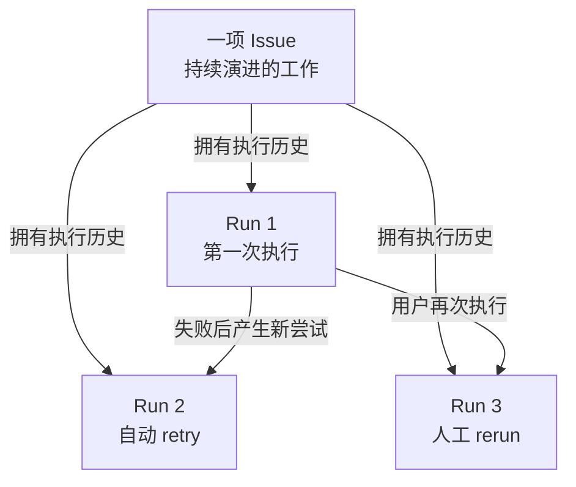
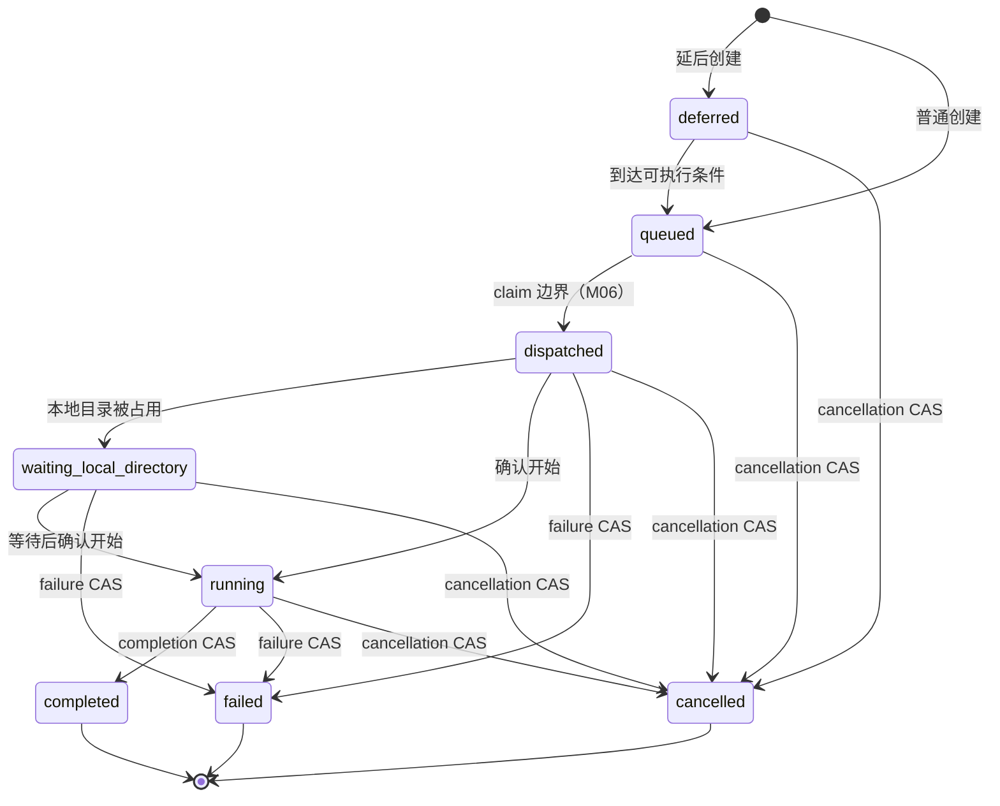
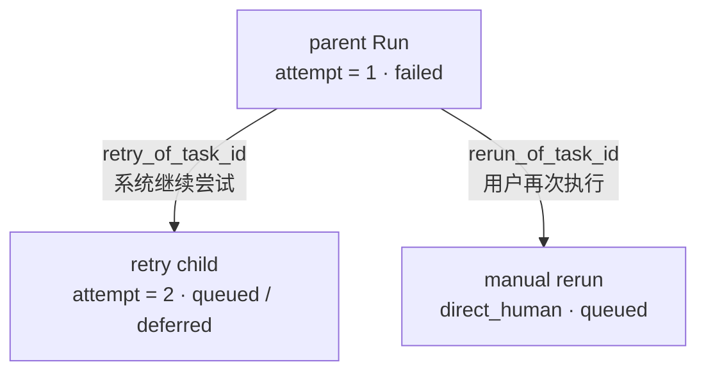

## 一次执行不能只活在内存里

沿用前几章的例子：你把“修复登录失败的问题”交给 Agent，Server 接受了这次触发。最简单的实现似乎是启动一个 handler 或 goroutine，再通知本地 Runtime 立刻工作。

但网页刷新、HTTP 请求结束、Server 重启或 Runtime 暂时离线之后，这段内存里的控制流都可能消失。系统仍需要回答：这次执行是否已经创建、现在走到哪一步、最后成功还是失败、失败后是否产生了新尝试，以及稍后怎样重新读到历史。

因此，Multica 不把 Run 仅仅当成“一次函数正在运行”。面向用户，**Run（运行）**是一次 Agent 执行；在固定版本的源码中，这个概念主要由一条持久 task record 表示。它有独立 ID、状态、来源、时间、结果和血缘，可以跨请求、进程和 Runtime 的时间边界继续存在。

本章固定在 `multica-ai/multica@231dedb55287ab6e40fd103634a024e4d9d1baeb`。我们先建立“一项 Issue 可以有多条 Run”的模型，再放大一条 Run 的创建、状态和历史。至于多个领取者怎样竞争同一条 `queued` 记录，留给 M06；完整故障分类、超时和孤儿恢复留给 M13。

## 先区分 Issue 与 Run

Issue 是一件持续演进的协作工作，例如“修复登录失败的问题”。它可以经历讨论、补充要求、代码审查和多次执行。Run 则是围绕这件工作发生的**一次执行尝试**。

下面是本章的**概念图**。中文节点是教学模型，不是 Go 类型或数据库表名。

<figure>



<figcaption><strong>CONCEPTUAL · Issue 与 Run：</strong>一项 Issue 可以关联多条独立 Run；retry 和 rerun 都新增记录，而不是把旧 Run 改回待执行状态。</figcaption>

</figure>

这张图先给出三个边界：

- Run 的终态判断的是**这一次执行**，不判断 Issue 目标是否已经完成；
- 同一 Issue 可以先失败、自动 retry，稍后又由用户手动 rerun；
- 新执行通过血缘指向旧记录，历史不会被覆盖。

源码里没有一个包办全部语义的中心 `Run` 类型。当前实现主要使用 `AgentTaskQueue` row、`TaskService` 以及 task-oriented SQL / API。产品概念与实现术语是映射关系，不是简单改名。

## 跟着一条 Run 走完生命周期

仍看“修复登录失败的问题”。一次被接纳的触发会经历以下语义阶段：

1. Server 确定目标 Agent、Runtime、来源与上下文。
2. Server 在数据库中创建一条有独立 ID 的待执行记录。
3. 记录写入成功后，Server 才提醒目标 Runtime 有工作。
4. Runtime 在后续阶段获得执行权并报告开始，记录进入执行中状态。
5. Runtime 报告完成、失败或取消，数据库保存这次执行的终态与结果。
6. 页面或 API 以后仍能按 Issue 读回这条历史记录。

第二步与第三步的顺序最重要：**先保存，再通知。** 通知只加速发现工作；数据库记录才说明这次 Run 已经存在。即使提醒丢失，`queued` 记录仍可由后续读取与检查路径发现。

```text
# 教学伪代码：不是 Multica 原始源码

run = insert_durable_run(
    issue_id=issue.id,
    agent_id=agent.id,
    runtime_id=runtime.id,
    status="queued",
    trigger=trigger_context,
)  # 先保存一次执行事实

notify_runtime(run.runtime_id)  # 再尽力提醒；通知不承载状态
```

固定提交中的 `(*TaskService).enqueueIssueTaskWithCommentPlan` 负责验证目标与来源并组织参数，`CreateAgentTask` 执行 insert。写入返回持久的 `AgentTaskQueue` 后，才会发布 queued event 并进入 `NotifyTaskEnqueued` / Runtime wakeup。

> 源码定位
>
> - `server/internal/service/task.go`：`(*TaskService).enqueueIssueTaskWithCommentPlan`、`(*TaskService).NotifyTaskEnqueued`
> - `server/pkg/db/queries/agent.sql`：`CreateAgentTask`
> - 作用：证明普通 Issue Run 先持久化为 `queued` row，再触发通知。

## 一条记录究竟记住什么

不需要背完 `AgentTaskQueue` 的所有字段。按职责分成六类，更容易理解它为什么是 durable task：

| 类别 | 代表信息 | 回答的问题 |
| --- | --- | --- |
| 身份与目标 | task ID、`agent_id`、`runtime_id`、可选 `issue_id` / `chat_session_id` | 这是哪次执行，交给谁，关联什么工作？ |
| 状态与时间 | `status`、创建 / 领取 / 开始 / 完成时间 | 它走到哪一步，何时发生？ |
| 来源与归因 | trigger、originator / accountable identity、证据引用 | 为什么产生这次执行，谁发起或承担责任？ |
| 执行连续性 | session、workdir、branch 等 | 本地执行以后如何关联既有上下文？ |
| 结果 | result、error、failure reason | 这次执行怎样结束？ |
| 血缘 | `attempt`、`parent_task_id`、`retry_of_task_id`、`rerun_of_task_id` | 新记录从哪次历史执行产生？ |

不同入口不会填满同一组字段。例如 Direct Chat 或 run-only Autopilot 的 task 可以没有 `issue_id`。本章使用 Issue-linked Run 讲解，不应反推“所有 Run 都属于 Issue”。

表名 `agent_task_queue` 也容易误导：row 不只在排队时存在。进入 `running` 或终态后，它仍作为 execution log 被读取，因此不能把它理解成“消费完就删除的临时队列项”。

## 状态怎样约束一次执行

下面的图是固定提交下的**实现状态图**。它只画 M05 需要的状态边界；`queued → dispatched` 的竞争与锁算法属于 M06。

<figure data-wide>



<figcaption><strong>IMPLEMENTATION · 单条 Run 的状态骨架：</strong><code>completed</code>、<code>failed</code> 与 <code>cancelled</code> 结束的是这次执行，不决定 Issue 是否完成；claim 的并发正确性留给 M06。</figcaption>

</figure>

状态不是由任意 endpoint 随意覆盖。SQL 会限制允许的来源状态：

- `StartAgentTask` 只接受 `dispatched` 或 `waiting_local_directory`；
- `CompleteAgentTask` 只把 `running` 改成 `completed`；
- `FailAgentTask` 可以从 `dispatched`、`waiting_local_directory` 或 `running` 进入 `failed`；
- cancellation 只转换仍 active 的记录，并保留原 row。

这里的**比较并交换（compare-and-swap，CAS）**可以理解为：“只有数据库中仍是允许的旧状态，才写入新状态。”允许来源状态直接写在 SQL predicate 中，所以状态正确性不只来自 Go service 的先后调用。

一个容易漏掉的状态是 `deferred`：记录已经持久存在，只是尚不可领取。例如媒体尚未完成绑定的 Channel Issue 可以先形成 `deferred` task，满足条件后再提升为 `queued`。这进一步说明“已经有 durable record”和“现在可被执行”是两件事。

## 为什么终态回调可以安全重放

网络重试可能让 Daemon 重复报告同一个完成或失败结果。若每次回调都重新执行终态副作用，系统可能重复结算、重复发事件或覆盖已经确定的结果。

当前实现把关键步骤放进事务：先用带状态条件的 SQL 尝试终态转换，同时结算相关 durable obligations；事务提交后，再处理分析、状态协调、事件和等待者通知。若 SQL 没有转换任何 row，service 会重新读取 task；如果它已经处于终态，就把这次回放视为“没有再次转换”的成功。

```text
# 教学伪代码：不是 Multica 原始源码

transitioned = compare_and_set_terminal(run_id, expected_active_state, result)

if transitioned:
    commit_durable_settlement()
    publish_post_commit_effects()  # 只为首次成功转换执行
else:
    current = load_run(run_id)
    if current.is_terminal():
        return idempotent_success(current)  # 观察既有事实，不再覆盖
```

这段机制的核心不是“回调永远只到一次”，而是**一条 durable row 只赢一次终态转换；重复回调只能观察已经保存的终态**。

> 源码定位
>
> - `server/internal/service/task.go`：`(*TaskService).CompleteTaskWithTransition`、`(*TaskService).FailTaskWithTransition`
> - `server/pkg/db/queries/agent.sql`：`CompleteAgentTask`、`FailAgentTask`
> - 作用：证明终态 CAS、事务内结算以及回放时的幂等返回。

## 自动 retry 为什么不是“把失败改回 queued”

假设第一次执行因允许自动重试的暂时性原因失败。旧记录已经说明“attempt 1 失败”；若把它改回 `queued`，失败时间、错误和审计历史都会被改写。

Multica 的做法是：保留 failed parent，在同一事务中创建新的 retry child。child 的 `attempt` 加一，并通过 `parent_task_id` / `retry_of_task_id` 指回 parent。它可以立即 `queued`，也可以按策略先 `deferred`。

<figure>



<figcaption><strong>IMPLEMENTATION · 两类血缘：</strong>自动 retry 与人工 rerun 都新增 row，但分别表达系统恢复尝试和新的用户意图；旧终态记录不被覆盖。</figcaption>

</figure>

failed parent 与 retry child 的创建位于同一事务中。这样，外部不会先看到“失败已提交”，却看不到本应同时产生的 retry 记录。至于哪些 failure reason 允许 retry、如何退避和何时耗尽，属于 M13。

## 人工 rerun 是新的用户意图

人工 rerun 也创建新记录，但语义不同。`POST /api/issues/{id}/rerun` 先验证成员与目标 Agent 的调用权限，再由 `TaskService.RerunIssue` 解析当前负责人或历史 Agent，最终创建带 `direct_human` attribution 的新 task。若用户明确选择来源 Run，新记录通过 `rerun_of_task_id` 指向它。

自动 retry 表达系统对一次失败的延续；人工 rerun 表达用户决定再执行一次。源码用两种 lineage 字段保存这个区别。当前实现不会为了 rerun 杀死已经执行中的 Run；新的记录会在同一 Agent / Issue 的后续序列化边界上等待。

本地 workdir 或 session 是否复用，不属于“旧记录被重置”。当前 claim 准备路径会结合被选择的来源、安全性和 Runtime 条件决定复用；教程不能把 rerun 简化成“必定从空目录开始”或“必定恢复旧 session”。

> 源码定位
>
> - `server/internal/service/task.go`：`(*TaskService).RerunIssue`、`(*TaskService).enqueueRerunTask`
> - `server/internal/handler/task_lifecycle.go`：`(*Handler).RerunIssue`
> - `server/pkg/db/queries/agent.sql`：`CreateRetryTask`
> - 作用：区分自动 retry 与人工 rerun 的新记录、归因与血缘。

## TaskService、SQL 与 handler 各负责什么

把全部正确性都归给 `TaskService` 也不准确：

- **handler** 处理 HTTP 输入、成员身份、workspace / invoke 权限和响应映射；
- **TaskService** 解析执行目标与 attribution，选择入队变体，组织事务，并协调提交后的通知、事件和状态处理；
- **SQL 与数据库事务** 保存 row，并用状态 predicate、CAS 和 lineage insert 固定关键状态边界。

这三层协作，才让一次 Run 同时拥有产品入口、服务编排与耐久事实。`TaskService` 是重要阅读入口，却不是唯一事实来源。

## Run 结束为什么不等于 Issue 完成

页面或 API 可以按 Issue 调用 `ListTasksByIssue`，把持久 rows 作为 execution log 重新读出。默认读取完整历史；active 模式只取非终态集合。`taskToResponse` 再把 row 映射成客户端看到的状态、时间、结果、错误、attempt、lineage 与 attribution。

这解释了两套生命周期为何必须分开：

- Run 的 `completed` 表示这次 Agent execution 正常结束；
- Issue 是否达到目标，还需要人审查结果、继续讨论、补充要求或明确更新工作状态；
- 同一 Issue 因而可以拥有多个 completed、failed 或 cancelled Run。

把 Run 终态自动解释成 Issue 完成，会丢失“执行结束”和“工作被验收”之间的协作空间。

## 这套设计带来的边界

以下两点是基于已验证结构的**工程解释（INFERENCE）**，不是源码注释直接声明的作者动机：

1. 把执行意图写成 durable row，使生产工作的一方与执行工作的一方不必共享同一个进程生命周期；双方通过数据库事实重新衔接。
2. 用新记录和 lineage 表达 retry / rerun，使恢复动作不必擦除失败证据，产品历史也能区分“系统继续尝试”和“用户再次要求执行”。

这些解释由先 insert 后 notify、历史读取、终态 CAS 与 lineage insert 支持；它们不构成 exactly-once execution 承诺，也不证明完整恢复策略。

## 容易混淆的八件事

1. **Run 不是 Issue。** 前者是一次执行，后者是持续协作的工作。
2. **Run 不是一个瞬时 HTTP 请求或 goroutine。** 当前实现把它保存成可重新读取的 task row。
3. **产品说 Run，源码多说 task。** 这是语义映射，不存在一个包办全部行为的中心 `Run` 类型。
4. **`agent_task_queue` 不只保存等待项。** running 与终态 row 继续充当 execution log。
5. **通知不是 Run，也不授予执行权。** 它发生在 insert 之后，只是 best-effort wakeup。
6. **终态属于一次执行。** `completed` 不自动等于 Issue done。
7. **retry 与 rerun 都不覆盖旧记录。** 二者新增 row，但血缘与意图不同。
8. **本章没有证明 claim 与完整恢复算法。** `queued → dispatched` 的并发正确性看 M06；故障恢复策略看 M13。

## 5 分钟快速复习

试着不用函数名回答：

1. 为什么一次执行不能只存在于 Server handler 或内存进程里？
2. 为什么必须先 insert，再通知 Runtime？
3. 一条 Run 需要保存哪六类信息？
4. CAS 怎样阻止终态回调重复覆盖结果？
5. 自动 retry 与人工 rerun 分别表达什么意图？
6. 为什么它们都要新增记录，而不是重置旧状态？
7. 为什么 Run `completed` 不代表 Issue 已完成？
8. “谁获得 `queued` Run”为什么是下一章的问题？

如果能说出下面这句话，就掌握了本章主线：

> Run 是一次 Agent 执行的耐久事实：它先于通知写入数据库，以受约束的状态推进并保留结果；retry 与 rerun 通过新记录和血缘延续历史，而不覆盖旧执行，也不替 Issue 判断工作是否完成。

---

## 附录：源码导航

下面的准确标识符用于核对固定提交，不是理解正文前需要背诵的术语。

### Source Map

| 源码位置 | 关键 symbol | 证明什么 | 证据 |
| --- | --- | --- | --- |
| `server/pkg/db/generated/models.go` | `AgentTaskQueue` | 持久 Run row 的身份、状态、结果、执行连续性与 lineage 字段 | `SOURCE` |
| `server/internal/service/task.go` | `TaskService` | enqueue、start、terminal、cancel、retry、rerun 与事务后副作用的编排入口 | `SOURCE` |
| `server/internal/service/task.go` | `enqueueIssueTaskWithCommentPlan` | 普通 Issue Run 解析目标 / 来源，先 insert 再进入事件和通知 | `SOURCE` |
| `server/internal/service/task.go` | `NotifyTaskEnqueued`, `notifyRuntimeMayHaveWork` | queued bookkeeping 与 best-effort Runtime work hint，不承载 task 状态 | `SOURCE` |
| `server/pkg/db/queries/agent.sql` | `CreateAgentTask`, `CreateDeferredChannelIssueTask` | 创建独立 UUID 的 `queued` / `deferred` row | `SOURCE` |
| `server/pkg/db/queries/agent.sql` | `ClaimAgentTask`, `StartAgentTask`, `MarkAgentTaskWaitingLocalDirectory` | `queued → dispatched → waiting / running` 的数据库状态边界 | `SOURCE` |
| `server/internal/service/task.go` | `CompleteTaskWithTransition`, `FailTaskWithTransition`, `CancelTaskWithResult` | 终态事务、幂等回放、取消与提交后处理 | `SOURCE` |
| `server/pkg/db/queries/agent.sql` | `CompleteAgentTask`, `FailAgentTask`, `CreateRetryTask` | 终态 CAS 与 retry child lineage insert | `SOURCE` |
| `server/internal/service/task.go` | `RerunIssue`, `enqueueRerunTask` | 人工 rerun 创建 direct-human 新记录并保留来源血缘 | `SOURCE` |
| `server/internal/handler/daemon.go` | `ListTasksByIssue` | 按 Issue 重新读取完整或 active execution history | `SOURCE` |
| `server/internal/handler/agent.go` | `AgentTaskResponse`, `taskToResponse` | 持久 row 到客户端 Run 形状的映射 | `SOURCE` |
| 官方 Runs 文档 | `Runs` | 一项 Issue 多条 Run、旧记录不覆盖、终态不等于 Issue done | `DOCS` |

### 精确执行 / 状态路径

```text
普通 Issue Run
  → TaskService.EnqueueTaskForIssue*
  → enqueueIssueTaskWithCommentPlan
  → CreateAgentTask(status = queued, identity / target / provenance / context)
  → persisted AgentTaskQueue
  → queued event
  → NotifyTaskEnqueued(runtime_id)

状态推进
  → deferred --promotion--> queued
  → queued --ClaimAgentTask; details in M06--> dispatched
  → dispatched --MarkAgentTaskWaitingLocalDirectory--> waiting_local_directory
  → dispatched | waiting_local_directory --StartAgentTask--> running
  → running --CompleteAgentTask CAS--> completed
  → active states --FailAgentTask / cancellation CAS--> failed | cancelled

自动 retry
  → FailTaskWithTransition(parent)
  → same transaction: parent = failed + CreateRetryTask(child)
  → child.attempt = parent.attempt + 1
  → child.parent_task_id / retry_of_task_id = parent.id

人工 rerun
  → POST /api/issues/{id}/rerun
  → Handler.RerunIssue
  → TaskService.RerunIssue
  → enqueueRerunTask
  → new queued row(direct_human, rerun_of_task_id = selected source)
```

### 源码基线、研究依据与未决问题

- 上游仓库：`multica-ai/multica`
- 完整 commit SHA：`231dedb55287ab6e40fd103634a024e4d9d1baeb`
- 研究产物：`research/durable-task/research-note.md`
- 图示证据：`research/durable-task/diagram-evidence.md`
- 证据类型：持久 insert、状态 predicate、事务、lineage 与历史读取来自 `SOURCE`；Run / Issue 产品语义与 retry 文案对照来自 `DOCS`；未运行 `EXPERIMENT`。
- `INFERENCE`：用“工作容器”比喻 Issue、用“带审计轨迹的一次执行尝试”比喻 Run，以及对进程解耦 / 历史保留的工程解释，都不是源码 identifier 或作者动机声明。

当前证据没有在本章证明 claim 候选排序、`FOR UPDATE SKIP LOCKED`、并发额度与唯一所有权；这些属于 M06。它也没有通过故障注入证明 timeout、offline、orphan recovery、退避与 exhausted behavior；这些属于 M13。`visibleTaskHistory` 对系统专用 task 的完整过滤边界不影响本章主线，但不能据此声称所有内部 row 都会作为普通用户 Run 展示。
