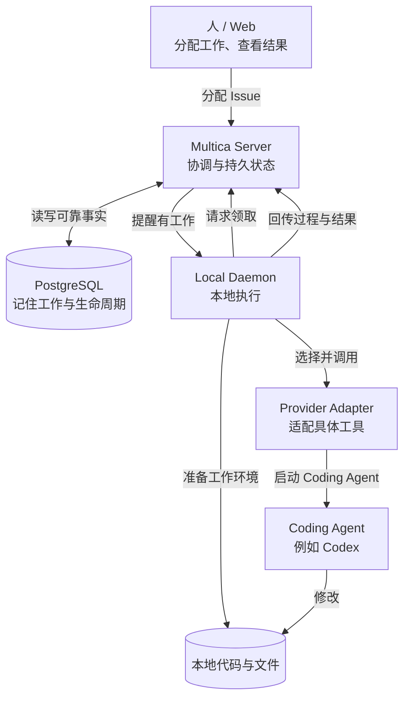
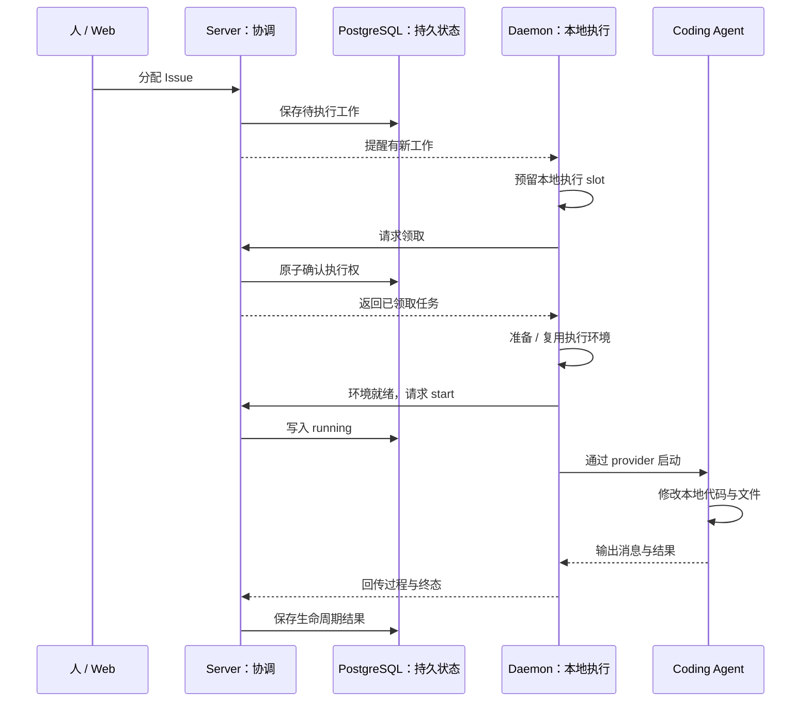
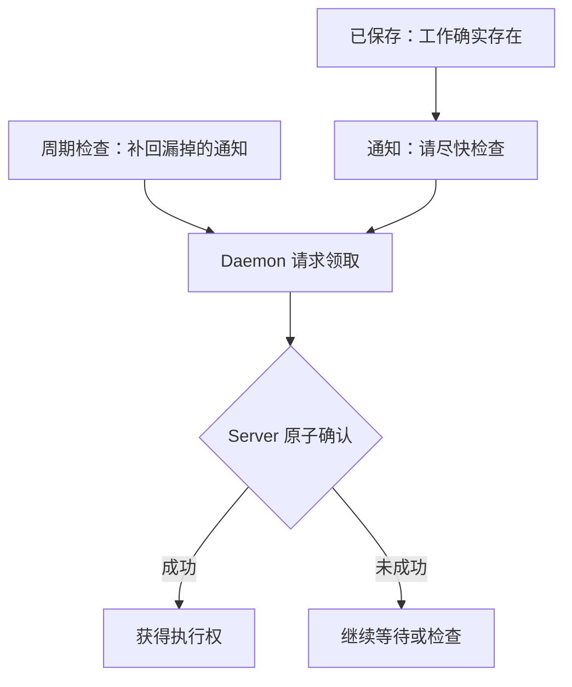
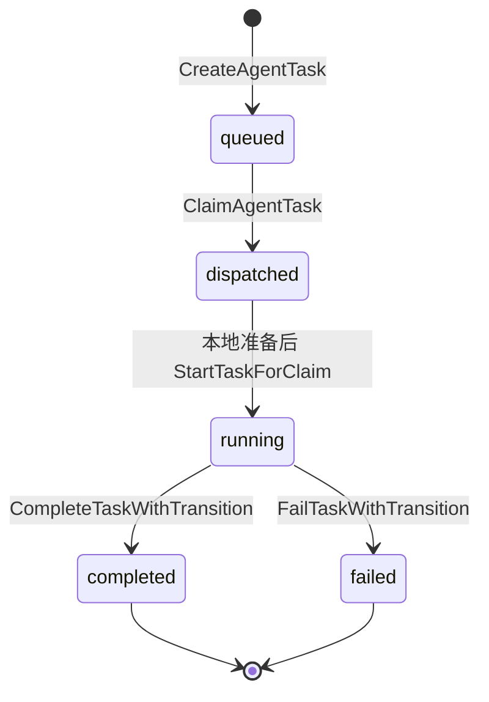

## Multica 把工作交给本地编码工具

如果你用过 Codex，可以先从一个熟悉的场景开始：打开代码仓库，告诉它“修复登录失败的问题”，让它检查文件、修改代码，再查看它的输出。这个过程里，你直接把工作交给了一个编码工具，也直接观察它的执行结果。

Multica 在这类编码工具外面增加了一层工作组织与执行协调。你可以把要做的事记录下来，交给配置好的 AI 协作者，再由系统把这次工作送到对应的执行环境，并记录执行过程和结果。**Multica 负责组织、分配和跟踪工作；Codex 等 Coding Agent 负责实际编码。** 理解这层分工，是读懂后面源码的起点。

本章沿用一个例子：你在 Multica 中记录“修复登录失败的问题”，把它分配给一个使用 Codex 的 Agent，并启动一次执行。这个 Agent 已经绑定到你 Mac 上的执行资源，Mac 上也已经运行着 Multica 的本地 Daemon。这里假设这些配置已经完成；本章讲的是配置好以后系统怎样接力工作。

先认识这个例子里的几个名字：

| 名称 | 在这个例子中表示什么 |
| --- | --- |
| **Issue** | “修复登录失败的问题”这件工作的协作记录。它描述要做什么，也保留工作状态和讨论。 |
| **Agent** | 被分配工作的 AI 协作者及其执行配置。它决定这次工作使用哪份执行资源；页面上的 Agent 与稍后启动的 Codex 进程需要区分。 |
| **Runtime** | Agent 绑定的执行资源注册与配置。本例指向 Mac 上可使用的 Codex 执行能力。 |
| **Run** | 围绕这件工作发生的一次具体执行。源码中主要用 task 术语表示它，后文会建立对应关系。 |
| **Daemon** | 在 Mac 上运行的 Multica 进程。它负责联系 Server、领取工作、准备本地环境，并调用编码工具。 |
| **Coding Agent** | 真正读取和修改代码的工具，本例使用 Codex。 |

这几个词分别描述工作、配置、执行资源和运行进程。先把它们放回例子就够了，不必现在记住数据库表或 Go 类型。更完整的对象关系会在 M02 展开。

## 先把整体系统放在同一张图上

从用户操作到代码修改，中间有两个主要位置：**Server 侧保存和协调工作，本地执行侧把工作变成真正的工具调用。** 网页是你分配工作、查看结果的入口；Server 接收这些操作，并把需要持续保存的状态写入 PostgreSQL 数据库；Mac 上的 Daemon 从 Server 领取工作，在本地准备好环境，再启动 Codex。

下面是本章的**教学架构图**。中文标签描述职责，不代表源码里存在同名类型；箭头表示主要交互，也不要求 Server 与数据库部署在两台不同机器上。

<figure>



<figcaption><strong>TEACHING · 最小架构图：</strong>Server 负责协调与持久状态；Daemon 和 Coding Agent 在本地机器上完成真正执行。读图时先记住这条边界，不必记函数名。</figcaption>

</figure>

读这张图时，可以从上往下看，再沿“回传过程与结果”回到 Server。

**网页与 Server 负责把人的决定变成可追踪的工作。** 在我们的例子里，你选择了 Issue 和负责人；Server 接收这次变更，判断是否应启动执行，随后保存一项待执行任务。它还负责处理执行侧的领取、开始和结束请求。这里的“协调”具体指的就是这些工作：记录目标，确认执行权，维护执行状态。

**PostgreSQL 保存跨越网络消息的事实。** “有一项工作在等待”“这项工作已经被领取”“这次执行已经结束”都需要留下记录。数据库里的任务记录与发给 Mac 的通知是两样东西：通知是一个即时提醒，任务记录则让 Server 在提醒没有送达时，仍能知道工作还在等待。

**Daemon 把服务端的安排接到本地资源上。** Server 上有工作记录，不意味着 Codex 已经启动。Daemon 需要先领取任务，再找到它对应的 runtime/provider 配置，准备或复用仓库与工作目录，然后调用本地工具。图中的 provider adapter 是对接具体 Coding Agent 的适配层：不同工具的启动方式和通信方式不同，这一层负责处理这些差异。

**Codex 负责实际编码，Daemon 负责接回输出。** Codex 在准备好的本地工作环境中读取、修改文件，产生消息和执行结果；Daemon 把这些信息回传给 Server。这样，分配工作和执行工作虽然发生在不同位置，仍然围绕同一次任务衔接起来。

Runtime 在图里没有单独画成一个运行进程，因为它提供的是执行目标与配置；Daemon 才是执行侧正在运行的进程。本例中 Agent 的 runtime 绑定把这次工作指向 Mac 上的 Codex 能力，Daemon 再负责兑现这份能力。

## 跟着“修复登录问题”走完一次执行

现在沿着同一个例子走一遍。先看正常情况下的完整旅程，再解释其中的约束。

### 1. 分配工作，留下待执行记录

你把“修复登录失败的问题”这个 Issue 分配给 Agent，并选择启动。Server 检查这次分配是否满足执行条件。如果满足，就保存一项待执行任务，记录它来自哪个 Issue、交给哪个 Agent，以及目标 runtime。

到这里，“需要执行”已经成为 Server 能查到的记录，但 Mac 还没有开始修改代码。任务的初始状态是 `queued`，可以理解为“已排队，等待符合条件的执行侧领取”。目标 runtime 来自 Agent 的绑定配置，因此这项任务不是交给任意在线电脑抢着做。

### 2. 提醒 Mac，等待 Daemon 检查

保存任务之后，Server 提醒目标执行侧有新工作。Daemon 收到提醒，会开始检查；即使提醒没有送达，它也会在周期检查中重新询问 Server。这里的检查只是为了发现工作，执行权还需要下一步确认。

### 3. 先留出本地容量，再请求领取

Daemon 同时能执行的工作有限。它先留出一个本地执行位置，再向 Server 请求领取任务；Server 检查任务和执行资源是否符合条件，成功后把任务状态写为 `dispatched`，并返回领取结果。

“领取”表示 Server 已确认这次执行权。Daemon 如果没有领到工作，就归还刚才预留的本地位置；如果领取成功，才继续准备这次执行。这个先预留、再领取的顺序来自本章研究的普通 `runBatchPoller` 路径；下面的旅程与教学伪代码都以这条路径为范围。

### 4. 准备环境，确认开始，再启动 Codex

Daemon 根据任务的 runtime 配置找到具体工具，准备或复用本地仓库、工作目录和执行环境。准备完成后，它向 Server 请求确认开始，Server 把任务记为 `running`。随后 Daemon 通过 provider 适配层启动 Codex，Codex 才开始处理“修复登录问题”这件工作。

这解释了两个容易误读的时刻：`dispatched` 表示已经领取，`running` 表示准备完成并成功确认开始。它们都比“收到提醒”更靠后，不能把这三个时刻混成一个。

### 5. 回传输出，记录这一次的结果

Codex 执行时会产生消息与结果。Daemon 在执行过程中回传消息和进度，结束后再报告成功或失败，Server 保存这次任务的终态。于是最初的 Issue 分配，经过服务端记录、本地领取与工具调用，形成了一次有起点、过程和结果的执行。

这里的终点是“一次执行结束”。登录问题是否真正解决、修改是否通过验收，还属于 Issue 的协作流程；我们会在后面单独解释这两种状态的关系。

把这五段合在一起，就得到下面的时序图。沿时间从上往下看，可以看到同一项工作怎样在各部分之间传递。

<figure>



<figcaption><strong>TEACHING · 一次执行的完整接力：</strong>Server 侧保存协调事实，本地侧完成真实执行；本章研究的普通 <code>runBatchPoller</code> 路径先预留本地 slot，再请求领取，claim 成功后才准备环境。图折叠了具体 API、函数和兼容分支。</figcaption>

</figure>

读到这里，你已经可以先用自己的话描述系统：**Server 保存待执行工作并提醒目标执行侧；Daemon 预留容量、请求领取、准备本地环境，再启动 Codex，并把过程与结果送回 Server。** 后面的机制解释围绕这条已经走过的路径展开。

本章只研究普通直接分配路径，上游固定为 `multica-ai/multica@b4ca5b4a23e68b26292a680dca7689a952bb1cd5`。有关完整恢复策略、所有 provider 行为及实时 UI 传播的证据边界统一列在文末。

## 为什么不能只发一条“RUN NOW”

最朴素的方案是：Server 给笔记本发送 `RUN NOW`，笔记本收到就启动 Codex。但真实环境里至少有五个问题：

- 通知可能在断网或重连时丢失。
- 机器可能暂时离线，但工作仍应保留。
- 多个执行者可能几乎同时看到同一项工作。
- 本地并发容量可能已经用满。
- 一条瞬时通信和“一项工作确实存在”不是同一种事实。

如果通知本身就是任务，通知丢了，任务也丢了；如果看到通知就算拥有任务，多个执行者可能重复启动。因此 Multica 把三件事拆开：**先记下来，再通知，再认领。**

下面的教学伪代码先暴露整体控制流。它不是 Multica 原始源码，也省略了校验、错误处理和兼容路径。

```text
# 教学伪代码：不是 Multica 原始源码

# Server：先保存工作，再提醒执行侧
task = save_pending_work()
notify_target_runtime(task)

# Daemon：简化为一次预留一个执行槽；真实路径支持批量领取
while can_reserve_local_capacity():
    slot = reserve_local_slot()  # 先预留本地容量，再请求领取
    task = try_claim_work()

    if task is None:
        release_local_slot(slot)  # 没领到任务，归还未使用的槽
        wait_for_notification_or_next_poll()
        continue

    try:
        prepare_or_reuse_environment(task)  # 准备仓库与工作目录
        confirm_task_start(task)  # Server 校验本次领取并写入 running
        execute_and_stream_messages(task)  # 启动配置的工具，执行中回传消息
        report_final_result(task)  # 执行结束后报告最终结果
    finally:
        # 在终态回调和本地清理完成后归还执行槽
        release_local_slot(slot)
```

这里的 `finally` 是教学表达。真实实现使用 `defer`：与任务配对的 slot 会在 terminal callback 和本地清理完成、`handleTask` 返回后归还。

下面沿着这段控制流逐步展开：先看 Server 怎样保存工作，再看 Daemon 怎样发现和领取，最后看环境准备、工具启动与结果回传。每一步都回到前面的登录问题例子。

## 保存任务，让工作在漏通知后仍有据可查

回到登录问题：Server 如果只发出“请执行”的消息，就无法仅凭这条消息判断 Mac 有没有收到、是否已经开始工作。把任务保存下来，才给后续检查提供了一个共同依据。Daemon 每次来领取，都可以询问仍在等待的工作，而不用依赖某条旧通知还在不在。

因此，保存任务与发送提醒承担不同职责：前者记录“要做的工作确实存在”，后者让执行侧更快注意到它。这个边界解释了先后顺序，也解释了为什么任务需要自己的执行状态。

Server 接受一次满足触发条件的分配后，会先创建一条状态为 `queued` 的持久任务。产品界面把一次 Agent 执行称为 **Run**；源码里主要把它称为 task。后面说“任务”时，指的就是这一次执行对应的内部记录，而不是整个 Issue。

阅读源码时，可以用这组对应关系定位：数据库表是 `agent_task_queue`，Go 模型是 `db.AgentTaskQueue`，贯穿 API 的标识是 `task_id`。源码中没有一个承担全局中心角色的 `Run` 类型。先理解“一次执行有自己的记录”，再记住这几个检索词即可。

这条任务会记录 `agent_id`、`runtime_id`、`issue_id` 和 `status` 等信息。`runtime_id` 来自 Agent 当时绑定的 runtime，因此它不是一条任意在线机器都能抢走的通用任务。机器暂时离线不一定阻止入队；真正领取时还会检查 runtime 是否在线、是否近期报告过活动，以及 Agent 是否仍绑定到它。执行侧定期报告活动的机制称为心跳（heartbeat），这里用它判断执行资源是否仍然活跃。

先写入 `queued`，再发送提醒，意味着：即使后面的网络提醒没有送达，工作仍然存在。Daemon 以后还能从 Server 的持久事实中重新发现它。

> 源码坐标：`server/internal/service/task.go` 的 `(*TaskService).enqueueIssueTaskWithCommentPlan` 组织入队；`server/pkg/db/queries/agent.sql` 的 `CreateAgentTask` 写入 `status='queued'`。

分配工作与启动执行也需要区分。你可以“只分配、不启动”，实现中由 `suppress_run` 表达这个选择。即使希望启动，Server 也要检查负责人、工作状态和执行配置是否允许入队。对应的 `(*IssueService).WillEnqueueRun` 包含 assignee、`backlog`、runtime 绑定、归档、访问、自循环和已有 pending task 等检查。本章的例子假设这些条件已经通过。

## 为什么收到通知还不算拥有任务？

任务持久化之后，Server 会发送一次**尽力而为的唤醒通知（best-effort wakeup）**。它的意思只是“可能有新工作，请尽快检查”，而不是“这项工作已经属于你”。通知可以丢失，也可以重复；它不改变任务状态。

设想登录问题的任务已经排队，Daemon 连续收到两次提醒。这说明它应尽快检查工作，但不意味着应该启动两次 Codex。再设想多个领取请求几乎同时到达 Server，它们也不能各自根据“我看到有任务”就开始执行。系统需要一个共同确认点，把“仍在等待”变成“已经交给某次领取”。

真正的执行权来自**原子认领（atomic claim）**：Server 在数据库中选择仍符合条件的 `queued` 任务，并把它变成 `dispatched`。选择候选和改变状态构成同一个不可分割的边界；并发领取请求不会都成功拿走同一项仍在排队的工作。

在登录问题的例子里，成功的领取请求拿到 `dispatched` 任务，Daemon 才能继续准备执行；其他请求不能再把同一条记录当作 `queued` 工作领取。这里保证的是这一认领边界，不能把它扩展为任务在所有故障与恢复场景下都“恰好执行一次”的承诺。

<figure>



<figcaption><strong>TEACHING · 通知与所有权：</strong>通知只加速发现，周期检查只恢复发现；只有 Server 的原子确认才授予执行权。精确实现坐标放在文末。</figcaption>

</figure>

把这段逻辑压缩成伪代码：

```text
# 教学伪代码：不是 Multica 原始源码

# 下面的选择、锁定与状态写入属于同一个数据库操作
candidate = lock_eligible_queued_task()

if candidate is not None:
    mark_dispatched(candidate)  # 将 queued 改为 dispatched
    return candidate  # 返回给成功领取它的执行者
```

前面的伪代码说“锁住一项 `queued` 任务，并在同一次操作里改成 `dispatched`”。Multica 具体怎样做到？下面这段真实 SQL 暂时只看两个地方：

1. `FOR UPDATE SKIP LOCKED`
2. `status = 'dispatched'`

以下代码来自固定基线中的 `ClaimAgentTask`。为了只展示认领骨架，runtime 健康度、当前绑定和串行约束等中间资格条件被折叠成一行明确的教程省略标记；除明确标出的教程省略行外，其余展示行保持固定上游基线原样。

```sql
UPDATE agent_task_queue
SET status = 'dispatched',
    dispatched_at = now(),
    prepare_lease_expires_at = now() + make_interval(secs => @prepare_lease_secs::double precision)
WHERE id = (
    SELECT atq.id FROM agent_task_queue atq
    WHERE atq.agent_id = @agent_id
      AND atq.runtime_id = @runtime_id
      AND atq.status = 'queued'
      -- … 教程省略：其他领取资格条件 …
    ORDER BY atq.priority DESC, atq.created_at ASC, atq.id ASC
    LIMIT 1
    FOR UPDATE SKIP LOCKED
)
RETURNING *;
```

`FOR UPDATE` 表示“这条候选记录接下来要被修改，先把它锁住”；`SKIP LOCKED` 表示“如果另一位领取者已经锁住某条候选，就跳过它，而不是同时拿走它”。外层 `UPDATE` 再把成功选中的记录写成 `dispatched`。选择候选与写入新状态位于同一条 SQL 语句中，这就是本章所说的原子所有权边界。

这段 SQL 展示的是认领骨架。完整实现还会检查 runtime 的绑定、在线状态、近期心跳、唤醒有效性，以及相关工作是否需要串行执行。省略这些条件后，我们可以先看清：请求怎样避开已锁住的候选，以及成功者怎样写入执行权。

容量控制还分布在认领前的两层，不能全部归到这段 SQL 上：

| 检查位置 | 负责的约束 | 源码坐标 |
| --- | --- | --- |
| Daemon 发送请求前 | 本地是否还有执行名额 | `runBatchPoller` 预留本地 slot |
| Server 调用认领 SQL 前 | 这个 Agent 的并发额度是否用满 | `TaskService.claimTask` 比较 `CountRunningTasks` 与 `agent.MaxConcurrentTasks` |
| 数据库认领操作 | 候选是否符合领取条件，并原子写入执行权 | `ClaimAgentTask` |

因此，Agent 并发上限由外层 service 检查，并非 `ClaimAgentTask` 中被省略的一条 SQL 条件。

> 源码坐标：`server/pkg/db/queries/agent.sql` 的 `ClaimAgentTask`，上游 commit `b4ca5b4a23e68b26292a680dca7689a952bb1cd5`。

WebSocket 是让两端保持连接、持续交换消息的通信方式。在这里，它有两个容易混淆的角色：`daemon:task_available` 是前面的唤醒事件；后面的 `tasks.claim` 则是通过连接发起的领取请求，也就是一次远程调用（RPC）。传输通道不是所有权语义，所有权仍以 Server 成功完成数据库 claim 为准。

## 通知加快发现，主动检查补回遗漏

任务已经保存在 Server，Daemon 仍然需要知道什么时候来查。正常情况下，提醒可以缩短等待；但如果 Server 发送提醒时 Mac 恰好断线，不能要求 Daemon 永远等着那条错过的消息。因此它还会主动检查：按一定间隔询问 Server 是否有自己可领取的任务。

通知走的是快速路径：正常送达时，Daemon 几乎立刻开始检查。主动检查，也就是轮询（polling），走的是安全发现路径：即使通知丢失或连接刚刚恢复，Daemon 仍会周期性询问 Server 是否有可领取的工作。

三种机制在这条路径上配合工作：

| 机制 | 解决的问题 | 不能保证什么 |
| --- | --- | --- |
| 唤醒通知 | 缩短正常情况下的等待时间 | 不保证送达，不授予执行权 |
| 周期检查 | 从漏通知或断连中重新发现工作 | 发现后仍不等于领取成功 |
| 原子认领 | 在并发条件下确认唯一执行权 | 不负责准备本地环境 |

Daemon 优先通过现有 WebSocket 发起 `tasks.claim` RPC，安全失败时可回退到 HTTP claim 路径。无论请求从哪条传输通道到达，最终都必须经过同一类 Server 端认领语义。

> 源码坐标：`(*Hub).NotifyTaskAvailable` 发送唤醒；`(*Daemon).pollLoop` 与 `(*Daemon).runBatchPoller` 负责被唤醒和周期检查；`(*Daemon).claimTasksWSFirst` 选择 claim 传输；`ClaimAgentTask` 决定所有权。

## 领取后还要准备环境，并确认开始

登录问题的任务被领取后，Codex 需要一个可以工作的目录，以及与这次任务对应的执行配置。服务端写下“任务已交给这次领取”，只能说明执行权已确认；它并不能代替本地创建或复用工作环境。因此“领取成功”和“环境准备好”是两个时刻。

同样，本地容量也必须提前考虑。可以把执行槽（slot）理解为 Daemon 管理的并发名额：先留出名额，才向 Server 要工作，避免本地已经忙满却继续领取。这个名额限制的是本地同时执行的数量；Server 上的 Agent 并发检查则是另一层约束。

在本章研究的普通 `runBatchPoller` 路径上，Daemon 会先预留本地 task slot，再向 Server 请求领取。这条顺序很重要：如果本地容量已经满了，就不应先把服务端任务变成 `dispatched`；如果 claim 没有返回足够任务，未使用的 slot 会被释放。领取成功后，Daemon 还要根据任务的 `RuntimeID` 找到本地 provider，并由 `execenv.Prepare` 或复用路径准备工作目录和执行环境。

只有环境准备完成，Daemon 才调用 start endpoint。Server 的 `StartTaskForClaim` 会核对这一次 claim 的 `runtime_id` 与 `dispatched_at`，再把 `dispatched` 改成 `running`。可以把 `runtime_id` 与 `dispatched_at` 理解为这次领取的身份与时间标记：Server 要确认请求对应的仍是当前这一次领取，避免旧请求影响更新后的执行权。只有 start 成功，Daemon 才继续调用 provider。

因此，`running` 表示本地环境已准备好，并且这一次开始请求通过了 Server 的确认。它也不等于“Codex 已经成功启动”：provider 调用在确认之后，启动工具仍可能失败。

普通直接分配主路径的状态如下。这是一张**实现图**，状态值和转换点都属于固定 commit 下的真实实现。

<figure>



<figcaption><strong>IMPLEMENTATION · task 主路径状态：</strong><code>queued → dispatched</code> 表示认领成功；环境准备和 start 成功后才进入 <code>running</code>。<code>[*]</code> 只是 Mermaid 起止记号，不是 Multica task 状态，也不表示终态后的数据库转换。</figcaption>

</figure>

`waiting_local_directory` 是一个已验证的可选分支：使用 in-place `local_directory` 且目录正被占用时，任务可以走 `dispatched → waiting_local_directory → running`。它不是所有任务的必经状态。`deferred` 用于定时或媒体门控路径，也不是普通直接分配的起点。

## Multica 怎样真正启动 Codex？

在前面的旅程里，我们一直说“Daemon 启动 Codex”。实际实现还隔着一层 provider 适配：任务领取、环境准备、结果回传是通用工作，而每种编码工具怎样启动、怎样接收输入、怎样产生输出，则需要按工具处理。把这两部分接在统一边界上，Daemon 才能沿同一条编排主线调用已配置的 Coding Agent。

环境准备之后，Daemon 并不直接把所有执行逻辑写死成 Codex。`agent.Backend` 定义统一执行边界，`ResolveBackend` 根据 runtime 的 provider/协议配置解析出具体 backend。可以把两边的职责这样分开：

- 边界之前：领取任务、准备环境、维护生命周期。
- 边界之后：启动并与某一种 Coding Agent 交互。

对本章的 Codex 路径，已验证的落点是 `codexBackend.Execute`，随后启动：

```text
codex app-server --listen stdio://
```

Codex 子进程通过 stdin/stdout 上的 JSON-RPC 2.0 与 backend 通信。这里的 JSON-RPC 只需理解为：两个进程用结构化请求、响应和通知交谈。这里需要记住的是：Daemon 调用适配层，适配层启动 Codex 子进程并与它通信。具体会话协议可以留到后续 provider 章节。

到这一步，最初在网页上的 Issue 分配，才真正成为 Mac 上运行的 Codex 进程。Multica 负责跨边界协调，Codex 负责具体编码工作。

> 源码坐标：`server/pkg/agent/agent.go` 的 `Backend` 定义边界；`server/pkg/agent/builtin_runtimes.go` 的 `ResolveBackend` 解析 backend；`server/pkg/agent/codex.go` 的 `codexBackend.Execute`、`executeOnce` 和 `buildCodexArgs` 落到 Codex 进程。

## 回传执行结果，再由协作流程判断工作是否完成

Codex 修改文件的过程中，Server 不会直接观察这个本地进程的每一步。Daemon 负责接收 provider 输出，并把执行消息、进度和最终结果送回去。这样，“执行中产生了什么”和“这一轮怎样结束”才进入服务端的记录。

执行期间，Daemon 从 provider session 读取消息，分批发到 `POST /api/daemon/tasks/{taskId}/messages`；粗粒度进度走单独的 `.../progress` endpoint。结束时，明确成功的结果发往 `.../complete`，其他结果发往 `.../fail`。Server 最终把 task 写成 `completed` 或 `failed`，并发布相应生命周期事件。

假设这一轮 Codex 已经完成修改，但你检查后发现另一个登录场景仍然失败，需要它继续处理。第一次执行已经结束，Issue 却还没有验收完成；新的执行仍然可以围绕同一个 Issue 发生。这就是 task 与 Issue 分开保存状态的意义：一个描述这一轮执行，另一个描述工作的持续协作。

两条路径可以并列观察：

```text
一次执行的生命周期：queued → dispatched → running → completed | failed

一种典型的 Issue 协作路径：todo → in_progress → in_review → done
```

task 的 `completed` 表示这一轮按完成结果结束，Server 不会因此自动把 Issue 改成 `in_review` 或 `done`。Coding Agent 会按所在 workspace 的工作流通过 CLI 更新 Issue，最终验收仍属于协作流程。一次执行成功与整件工作完成，需要分别判断。

上面的 Issue 状态链只是一个典型示例。workspace 可以配置或增加自定义 Issue status，具体 Issue 也不必逐项经过这些状态。这里需要记住的是两套模型的分工，而不是背下示例中的全部状态。

本章的证据只覆盖到 Server 已提交的任务状态与生命周期事件；事件如何完整传播到所有实时 UI，不在当前研究范围内。

## 把整条接力放回最初的例子

“修复登录问题”首先是一条 Issue 协作记录；启动执行后，Server 又保存了这一次的 task。通知让 Mac 尽快检查，认领确认执行权，本地环境准备让工具有地方工作，provider 把通用执行流程接到 Codex，结果回传则让 Server 知道这一轮执行怎样结束。开篇架构图里的每条主要连线，到这里都有了具体含义。

从工程角度看，这个结构把“可靠记录、及时发现、执行权确认、本地工具调用”分别交给了不同机制。数据库记录让漏通知后仍有工作可查；通知缩短正常等待；认领处理并发领取；本地 Daemon 连接仓库与编码工具。这是对本章已验证机制的工程解释，不能据此推断完整的重试保证、性能指标或作者的主观设计动机。

## 容易混淆的五件事

1. **Server 不是 Coding Agent。** 它负责协调与记录；Codex 等工具在执行侧工作。
2. **产品 `Run` 不是源码中心类型 `Run`。** 当前实现主要使用 `agent_task_queue`、`TaskService` 和 `task_id` 等 task 术语。
3. **通知不是所有权。** `daemon:task_available` 只提示检查；成功 claim 才产生 `dispatched` 所有权。
4. **polling 不是认领。** 它负责重新发现工作；发现以后仍须 Server 原子确认。
5. **task 终态不是 Issue 终态。** `completed` 与 `done` 分属执行生命周期和协作流程。

## 可以带走的工程经验

- 先把不可丢的事实持久化，再用即时通知加速。
- 把“发现工作”和“获得执行权”分成两个清晰动作。
- 用原子状态迁移表达所有权变化，而不是依赖某个进程的内存标记。
- 先确认本地容量，再领取远端工作；先准备环境，再声明 `running`。
- 用 provider 边界隔离通用编排与具体 Coding Agent。
- 不要用一套状态解释执行对象与协作对象。

## 5 分钟快速复习

试着不用任何函数名回答：

1. Server、Daemon 和 Codex 各负责什么？
2. 为什么要先保存任务，再提醒机器？
3. 通知、轮询和认领分别解决什么问题？
4. 哪一步真正改变执行权？
5. 为什么领取后不能立即启动 Codex？
6. provider 边界隔开了哪两类职责？
7. 为什么一次执行结束不等于 Issue 已被验收？

如果能说出下面这句话，你已经掌握主线：

> Server 先保存工作并提醒机器；Daemon 发现后请求领取，Server 原子确认执行权；Daemon 再准备本地环境、通过 provider 启动 Coding Agent，并把结果送回 Server。

## 想继续读源码？

到这里，读者侧的解释已经完整。下面是用于核对实现的精确源码坐标；不需要为了理解主线而记忆它们。

### Source Map

所有实现条目均来自 `research/run-lifecycle/research-note.md`，证据等级为 `SOURCE`；产品术语与部分行为边界另有该研究中标注的 `DOCS` 支持。

| 源码位置 | 关键 symbol | 证明什么 |
| --- | --- | --- |
| `server/internal/handler/issue.go` | `(*Handler).UpdateIssue` | 保存 assignee 变化，并进入执行触发判断 |
| `server/internal/service/issue_trigger.go` | `(*IssueService).WillEnqueueRun` | 判断当前分配是否允许入队 |
| `server/internal/handler/issue_trigger.go` | `(*Handler).dispatchIssueRun` | 把直接 Agent 触发交给 task 路径 |
| `server/internal/service/task.go` | `(*TaskService).enqueueIssueTaskWithCommentPlan` | 解析 runtime、创建任务、发布 queued 事件并提醒 runtime |
| `server/pkg/db/queries/agent.sql` | `CreateAgentTask` | 写入 `status='queued'` 的持久记录 |
| `server/internal/daemonws/hub.go` | `(*Hub).NotifyTaskAvailable` | 发送 best-effort 的 `daemon:task_available` 提示 |
| `server/internal/daemon/daemon.go` | `(*Daemon).pollLoop`, `(*Daemon).runBatchPoller` | 接收唤醒、周期检查，并在 claim 前预留本地容量 |
| `server/internal/daemon/wsrpc.go` | `(*Daemon).claimTasksWSFirst` | WebSocket RPC 优先，安全失败时回退 HTTP |
| `server/internal/service/task.go` | `(*TaskService).ClaimTasksForRuntimes`, `(*TaskService).claimTask` | 应用 runtime、Agent、容量与新鲜度条件 |
| `server/pkg/db/queries/agent.sql` | `ClaimAgentTask` | 原子执行 `queued → dispatched` |
| `server/internal/daemon/daemon.go` | `(*Daemon).handleTask`, `(*Daemon).runTask` | 路由本地 runtime、准备环境、确认 start、调用 provider |
| `server/internal/daemon/execenv/execenv.go` | `Prepare` | 建立 Coding Agent 使用的本地执行环境 |
| `server/internal/service/task.go` | `(*TaskService).StartTaskForClaim` | 校验 claim generation，并进入 `running` |
| `server/pkg/agent/agent.go` | `Backend`, `New`, `ExecOptions` | 定义统一 provider 执行边界 |
| `server/pkg/agent/builtin_runtimes.go` | `ResolveBackend` | 把 runtime/provider 配置解析为 backend |
| `server/pkg/agent/codex.go` | `codexBackend.Execute`, `executeOnce`, `buildCodexArgs` | 启动 `codex app-server --listen stdio://` |
| `server/internal/daemon/daemon.go` | `(*Daemon).executeAndDrain`, `(*Daemon).reportTaskResult` | 回传消息、进度和最终结果 |
| `server/internal/handler/daemon.go` | `ReportTaskMessages`, `CompleteTask`, `FailTask` | 接收 daemon 回传并进入服务端状态处理 |
| `server/internal/service/task.go` | `CompleteTaskWithTransition`, `FailTaskWithTransition` | 幂等写入 `completed` 或 `failed` 并发布事件 |

### 精确执行 / 调用链

下面是根据研究整理的 happy path，省略参数校验、日志与辅助调用：

```text
PUT /api/issues/{id}
  → Handler.UpdateIssue
  → IssueService.WillEnqueueRun
  → Handler.dispatchIssueRun
  → TaskService.EnqueueTaskForIssueWithHandoff
  → enqueueIssueTaskWithCommentPlan
  → CreateAgentTask(status = queued)
  → publish task:queued
  → EmptyClaim.Bump
  → NotifyTaskAvailable(runtime_id, task_id)
  → daemon taskWakeupLoop / pollLoop
  → runBatchPoller（先预留本地 slot）
  → claimTasksWSFirst
  → WS RPC tasks.claim，或 HTTP fallback
  → Handler.ClaimTasksByRuntime
  → TaskService.ClaimTasksForRuntimes
  → claimTask
  → ClaimAgentTask: queued → dispatched
  → daemon handleTask / runTask
  → execenv.Prepare 或复用已有环境
  → POST /api/daemon/tasks/{taskId}/start
  → StartTaskForClaim: dispatched → running
  → agent.ResolveBackend(...)
  → agent.Backend.Execute(...)
  → codexBackend.Execute / executeOnce
  → codex app-server --listen stdio://
  → POST .../messages 与 .../progress
  → reportTaskResult
  → POST .../complete 或 .../fail
  → CompleteTaskWithTransition 或 FailTaskWithTransition
  → completed 或 failed + lifecycle event
```

### 源码基线、研究依据与证据边界

- 上游仓库：`multica-ai/multica`
- 完整 commit SHA：`b4ca5b4a23e68b26292a680dca7689a952bb1cd5`
- 研究产物：`research/run-lifecycle/research-note.md`
- 图示证据：`research/run-lifecycle/diagram-evidence.md`
- 证据类型：实现结论以 `SOURCE` 为主；产品 Run/task 术语映射、Daemon 的轮询/心跳背景和 Issue 状态边界同时参考 `DOCS`。本章未新增 `EXPERIMENT`。

现有证据不足以完整解释：重试策略、stale dispatch recovery、heartbeat/离线恢复全生命周期、多实例 wakeup relay 与 Redis 细节、实时 UI 的完整事件传播、`execenv.Prepare` 的全部内部机制、claim payload/授权的所有字段，以及所有自定义 runtime/provider 行为。本章有意不把这些未决部分写成确定事实。
