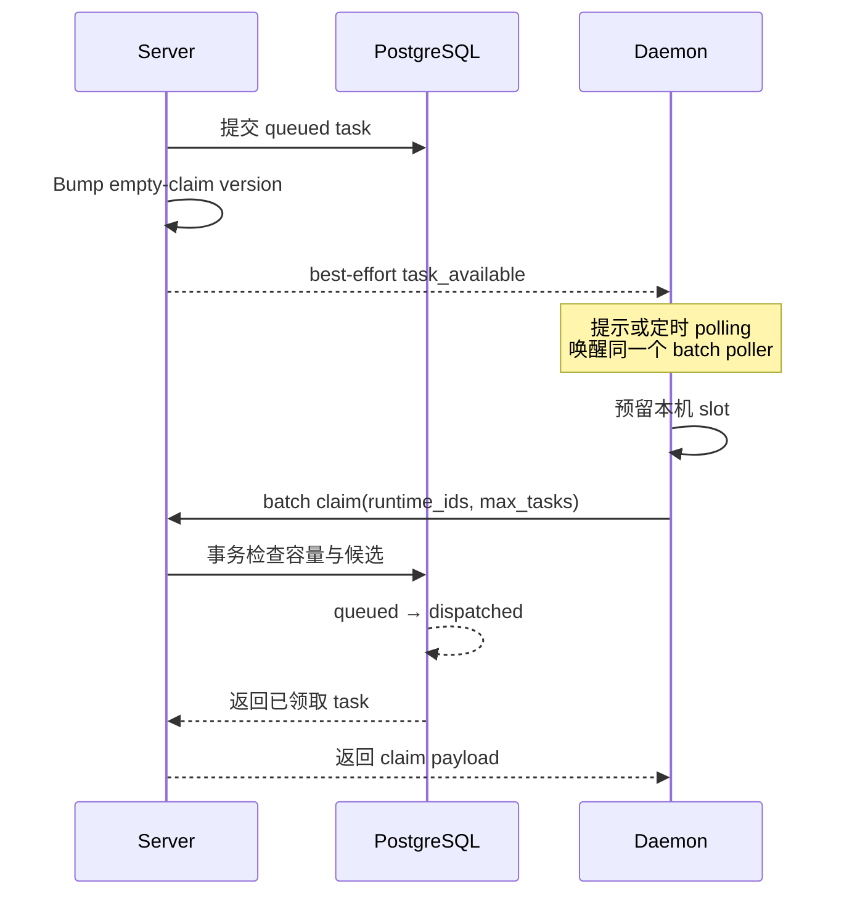
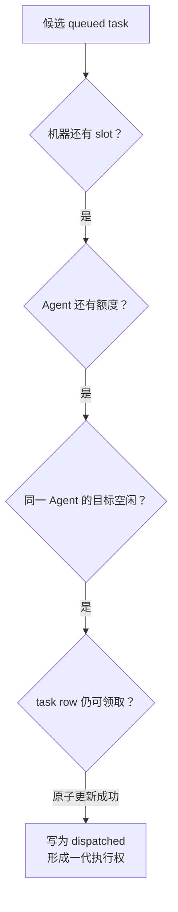
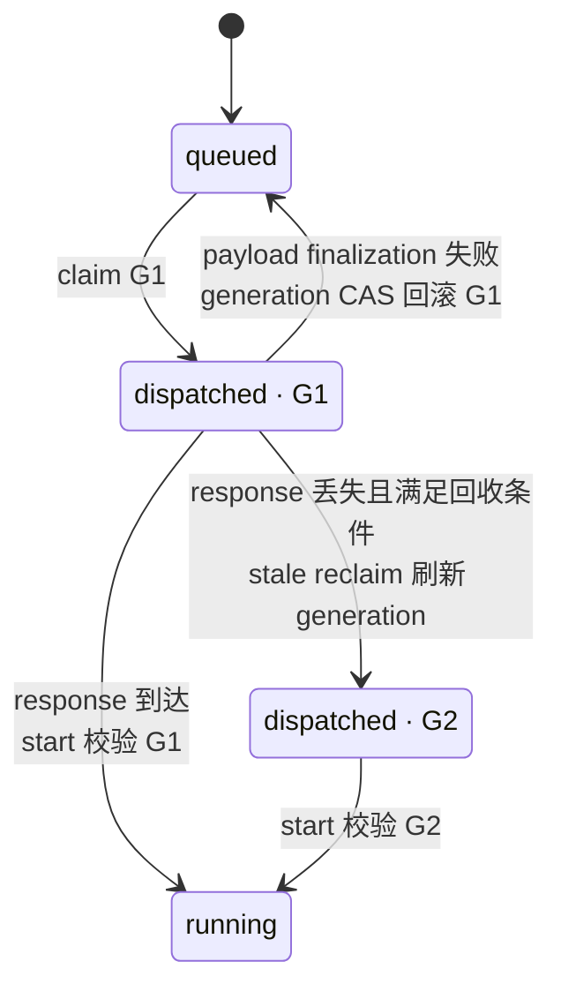

## 门铃响了，不等于包裹已经归你

沿用前几章的例子：“修复登录失败的问题”已经成为一条状态为 `queued` 的 durable task。Server 希望 Mac 上的 Daemon 尽快来检查，于是发送一条 `task_available` 消息。

可以先把它想成门铃：门铃告诉屋里的人“门外可能有包裹”，但谁听见铃声，谁并不会因此自动成为包裹的合法签收人。真正的签收还要核对收件目标、接纳能力，并在一份共同记录上留下不可混淆的结果。

这个类比只用于区分两件事：

- **发现工作**：wakeup hint（唤醒提示）与 polling（轮询）让 Daemon 知道现在值得检查；
- **获得执行权**：claim（领取）在数据库中把一条合格记录从 `queued` 原子推进为 `dispatched`。

提示可以重复、合并或丢失；轮询也可能由多个请求同时发生。它们都不直接改变 task 状态。**数据库中的 claim 才是本章的所有权边界。**

本章固定在 `multica-ai/multica@231dedb55287ab6e40fd103634a024e4d9d1baeb`。当前实现使用单机级 batch poller，并优先尝试 WebSocket claim RPC；不要把旧资料中的“一条 Runtime 一个 HTTP poller”当成现状。

## 先建立最小心智模型

先不看函数名，可以把一次领取理解为五个语义阶段：

```text
Server 已保存 queued task
→ 提醒 Daemon 有工作可检查
→ Daemon 预留本机容量并请求领取
→ Server 检查目标、额度和竞争条件
→ 数据库写入 queued → dispatched
```

前两步解决“如何更快发现”，后三步才回答“是否有资格接纳、谁最终赢”。其中有三个角色：

| 角色 | 本章中的职责 |
| --- | --- |
| Server | 保存 task，发送 best-effort 提示，验证 claim 请求并组织领取事务 |
| Daemon | 汇合提示与定时检查，先预留本机 slot，再为它管理的 Runtime 批量请求任务 |
| PostgreSQL | 保存权威 task 状态，用事务、锁和状态条件决定 winner |

这里先把 Runtime 当成领取请求中的执行目标。它怎样注册、heartbeat 怎样维持在线状态，属于 M07；本章只使用“Runtime 必须符合当前领取条件”这个已经验证的前提。

## 跟着一条任务走完领取旅程

假设 Daemon 还有两个空闲 slot，而 Agent 只剩一个并发名额。Server 已经提交一条 `queued` task，随后先让近期“此 Runtime 没有任务”的缓存结论失效，再发送 wakeup hint。Daemon 收到提示后唤醒 batch poller；如果提示没有送达，定时 polling 以后也会唤醒同一个 poller。

poller 不会见到提示就直接启动 Coding Agent。它先预留本机 slot，然后把自己管理的 Runtime 集合与可接纳数量发给 Server。Server 验证 Daemon 身份、Runtime ownership 与 `max_tasks`，再进入批量 claim。对于候选 Agent，事务会锁住 Agent row、重新计算 active task 数，并在额度允许时尝试领取一条合格 task。成功的 SQL 把记录写为 `dispatched`；这个结果才表示一代执行权已经形成。

下面是固定基线下的**实现顺序图**。它回答的唯一问题是：一条 durable task 怎样从“可被发现”走到“已被领取”？

<figure data-wide>



<figcaption><strong>IMPLEMENTATION · 从提示到所有权：</strong>先持久化，再使空结果缓存失效并尽力提示；Daemon 预留本机容量后才请求领取。只有数据库中的 <code>queued → dispatched</code> 改变执行权。</figcaption>

</figure>

这张图刻意没有把 wakeup 画成 task 交付。`task_available` payload 只带 Runtime / task 标识，不携带 task 内容、token 或 ownership。即使 relay 发布失败、Hub 没有连接、重复消息被本地 buffer 合并，数据库里的 `queued` 事实也没有变化。

## 为什么提示之前要先让空缓存失效

Server 会缓存“最近查过，这些 Runtime 没有任务”的结果，以避免每次空轮询都读取完整候选集合。新 task 写入后，`notifyTaskAvailable` 先调用 `EmptyClaim.Bump(runtime_id)`，再进入 `NotifyTaskAvailable`。

顺序不能反过来。若先提示，Daemon 可能立刻 claim，却仍命中旧的“空队列”结论。先 bump version 意味着这次检查不能继续信任旧空结果。缓存仍只是性能优化：缓存缺失或失败时，领取可以继续走数据库路径，它不拥有正确性。

```text
# 教学伪代码：不是 Multica 原始源码

task = commit_queued_task()
invalidate_empty_result(task.runtime_id)  # 旧的“无任务”结论失效
send_best_effort_hint(task.runtime_id)    # 提示可丢失，不改变 task 状态
```

> 源码定位
>
> - `server/internal/service/task.go`：`(*TaskService).notifyTaskAvailable`、`notifyRuntimeMayHaveWork`
> - `server/internal/daemonws/notifier.go`：`(*RelayNotifier).NotifyTaskAvailable`、`notifyTask`
> - 作用：证明 cache invalidation 先于 best-effort hint，且通知不承载 task 内容或所有权。

## Polling 为什么仍然不可省略

即时提示的价值是低延迟，不是可靠送达。Daemon 的 WebSocket 连接可能暂时断开，relay 可能发送失败，本地有界 channel 也可能把一阵重复信号合并成一次。只要 task 已经持久化，这些情况都不应让它永久消失。

因此，提示、重连后的 catch-up nudge、Runtime 集合变化、task 结束释放 slot，以及定时 safety poll，最终都汇入 `pollLoop`，再触发同一个 `runBatchPoller`。一次 batch claim 会重新查看这台机器管理的全部 Runtime 的 durable state，所以提示不需要逐条可靠排队。

当前基线有两种主要检查节奏：

- 若没有可用的健康 WS claim 能力，或结果处于不确定状态，保留普通 `PollInterval`；默认值是 `30s`。
- 健康 WebSocket 且双方支持 `rpc-v1` / `claim-poll-hints-v1` 时，空闲检查使用带 downward-only jitter 的 safety poll；默认 `3m` 上限对应约 `2m30s–2m45s`。

这些时间是固定基线中的默认配置，不是系统对领取延迟的保证。deferred task 的相对 delay 还可以缩短下一次 poll。

## WebSocket 与 HTTP 为什么不会产生两套所有权

Daemon 的 `claimTasksWSFirst` 优先通过 WebSocket 调用 `tasks.claim`。若能力不支持或运输明确安全失败，它可以回退到 HTTP `POST /api/daemon/tasks/claim`。两条通道最终复用 `ClaimTasksByRuntime`，使用同形 request / response，再进入相同的 `ClaimTasksForRuntimes` 与数据库 claim。

所以，WebSocket 和 HTTP 是**运输选择**，不是两个独立 ownership authority。

有一个关键例外：若 WebSocket frame 可能已经到达 Server，只是 response 因断线没有回来，结果就是“不确定”，而不是“明确失败”。Daemon 此时不会立刻再发一次 HTTP claim；它跳过本轮，等待 safety window。否则，同一批本地空位可能先承接一批已经提交但 response 丢失的 WS claims，又立即承接第二批 HTTP claims。

```text
# 教学伪代码：不是 Multica 原始源码

outcome = try_ws_claim()

if outcome.is_success:
    accept(outcome.tasks)
elif outcome.is_safe_to_retry:
    accept(http_claim())
else:
    wait_for_safety_poll()  # 可能已提交，不能立即双投
```

## 领取前为什么有四道不同的门

“并发限制”听起来像一个数字，实际至少包含四个不同作用域。下面是**概念图**：四道门来自已验证实现，但“四道门”是教学模型，不是源码中的统一 abstraction。

<figure>



<figcaption><strong>CONCEPTUAL · 四种约束：</strong>本机 slot、Agent 额度、同一 Agent 的目标序列化和单 row winner 解决的是不同竞争；通过前一层不代表自动通过后一层。</figcaption>

</figure>

### 第一层：Daemon machine slot

`runBatchPoller` 先获取至少一个本地 slot，再尽量收集更多空闲 slot。claim request 的 `max_tasks` 等于本轮预留数量；Server 还把单次 batch 限为 32。

这保证 Server 把 task 写成 `dispatched` 前，Daemon 已有位置接纳它。若先 claim 再等本机容量，任务可能仅因本机忙满而滞留在已领取状态。没有实际返回 task 的预留 slot 会被释放；任务结束后也会释放 slot 并再次唤醒 poller。

### 第二层：Agent concurrency cap

机器有空位，不代表目标 Agent 仍有额度。`claimTask` 在事务中先用 `GetAgentForClaimUpdate ... FOR UPDATE` 锁住 Agent row，再调用 `CountRunningTasks`，与 `agent.max_concurrent_tasks` 比较。

计数不只包含 `running`，还包含 `dispatched` 与 `waiting_local_directory`。准备中的 task 和等待本地目录的 task 以后仍可能继续运行，因此它们已经占用 Agent capacity。对同一 Agent 的并发 claim 会在 row lock 处串行；后一个事务必须在前一个提交后重新计数，不能共同使用过期的 active count 越过上限。

### 第三层：同一 Agent 的目标序列化

Agent 的上限大于 1，也不表示它能同时重入同一个工作目标。`ClaimAgentTask` 会排除同一 Agent 已有 active task 所指向的相同 Issue、相同 `chat_session_id`，以及没有 Issue / Chat / Autopilot relation 的同类 quick-create 目标。

这是 **per-Agent、per-target** 的约束，不是全局 Issue lock。不同 Agent 仍可并行处理同一 Issue。task 从 `dispatched` 起就占用这层防护，不必等到 `running`。

### 第四层：单 row winner

最后，`ClaimAgentTask` 按 priority 降序、创建时间和 ID 升序选择候选，用 `FOR UPDATE SKIP LOCKED` 避开已被竞争者锁住的 row，并只更新仍为 `queued` 的记录。竞争者要么跳过锁住的候选，要么发现它已经不再满足 `status='queued'`。

这段教学伪代码只保留决定 winner 的骨架：

```text
# 教学伪代码：不是 Multica 原始源码

lock_agent_and_recount_capacity()

if agent_has_capacity():
    candidate = select_eligible_queued_row_skip_locked()
    if candidate is not None:
        mark_dispatched(candidate)  # 与候选选择处于同一 SQL / 事务边界
```

> 源码定位
>
> - `server/internal/daemon/daemon.go`：`(*Daemon).runBatchPoller`
> - `server/internal/service/task.go`：`(*TaskService).ClaimTasksForRuntimes`、`claimTask`
> - `server/pkg/db/queries/agent.sql`：`GetAgentForClaimUpdate`、`CountRunningTasks`、`ClaimAgentTask`
> - 作用：分别证明本机接纳能力、Agent quota、per-target fence 与单 row 原子 winner。

## Batch claim 为什么没有削弱单条 task 的边界

当前 Daemon 不再为每条 Runtime 启一个独立 HTTP poller，而是把自己管理的 Runtime IDs 放进一次 machine-level batch claim。这样改变的是请求组织方式，不是所有权来源。

`ClaimTasksForRuntimes` 会先处理到期 deferred task 与合格的 stale dispatch，再结合 empty-claim cache 和候选排序寻找工作；对于不同候选 Agent，它仍逐个进入 `claimTask` 的事务边界。前面已经成功提交的 task 会作为 partial success 返回，不会因为后续候选出错就假装整批没有发生。

因此，可以同时记住两句话：

- batch 提高一台机器检查多个 Runtime 的效率；
- 每条 task 仍由相同的 SQL 状态转换形成自己的 claim generation。

## `dispatched` 为什么不等于工具已经运行

`ClaimAgentTask` 写入 `dispatched`，表示 task 已被领取，Daemon 正准备启动工具。只有本地环境准备完成，并且 `StartTaskForClaim` 核对当前 claim 后，状态才进入 `running`。

所以本章讨论的是“哪一代领取拥有继续启动的资格”，不是“Coding Agent 已经成功工作”。本地目录怎样准备属于 M08，provider 怎样启动属于 M10。

这个区别也解释了为什么 `dispatched` 和 `waiting_local_directory` 会占用 Agent capacity：它们虽然还没进入 `running`，却已经是可能继续执行的 active work。

## Claim response 丢失时，旧一代为什么不会一直有效

领取成功后，handler 还要在写 response 前完成 task-scoped token、可选 daemon token、Issue snapshot 与 comment receipt 等 payload finalization。这里会出现三种结果：

1. finalization 失败：用本次 `dispatched_at` 做 CAS，只回滚这一代 claim；
2. response 正常到达：Daemon 带 task ID、Runtime ID 与该代 `dispatched_at` 请求 start；
3. Server 已提交 claim，但 response 丢失：task 暂时保留 `dispatched`，满足 recovery window 与 lease 条件后才能被重新领取。

`dispatched_at` 在这里充当领取代次（claim generation）的标识。重新领取会刷新它，从 G1 变为 G2；旧 G1 的 start 或 replay 不能再确认 G2。

<figure data-wide>



<figcaption><strong>IMPLEMENTATION · 领取代次：</strong>重新领取会刷新 <code>dispatched_at</code>；start / replay / reclaim 围绕 task、Runtime 与 generation 串行化，因此旧 G1 不能继续确认新的 G2。</figcaption>

</figure>

图中两条边分别写明 G1 / G2，是为了展示“由哪一代 start 成功”；数据库状态值始终只是 `running`。`LockAgentTaskStartClaim` 使用 task ID、Runtime ID 与 `dispatched_at` 锁定当前 start claim，使旧代请求无法越过新代。

这不是“恰好一次执行”的完整证明。dispatch timeout、Daemon crash 后的 terminal treatment、offline settlement、自动 retry 和 backoff 属于 M13。本章只确认：response 丢失不会让两代 claim 同时成为合法的当前 owner。

## 把机制重新合起来

现在回到开头那条 `queued` task：

1. durable row 先存在，提示才有意义；
2. cache bump 防止新任务仍被旧空结果遮住；
3. wakeup 加速检查，polling 补回漏掉的提示；
4. Daemon 先预留 machine slot，再发 machine-level batch claim；
5. Server 验证 Daemon / Runtime 范围，并逐 Agent 进入领取事务；
6. Agent quota、per-target fence 与 row lock 依次约束候选；
7. `queued → dispatched` 形成一代 durable ownership；
8. start 还要校验当前 generation，之后才进入 `running`。

这套结构没有把正确性压在 WebSocket、Redis relay 或某个 Daemon 的内存上。它们可以改善发现速度和空检查成本；持久队列、SQL predicate、事务与 generation CAS 才决定当前执行权。

## 容易混淆的九件事

1. **Daemon wakeup 不是 Issue Wakeup。** 前者是已持久化工作可检查的提示；后者是 M04 讨论的产品 trigger 配置。
2. **收到 `task_available` 不等于收到 task。** payload 不承载完整工作或 ownership。
3. **polling 不等于 claim。** 它只让 Daemon 发起检查；数据库仍须确认 winner。
4. **WebSocket 与 HTTP 不是两套所有权。** 它们复用同一 handler 与 service claim 路径。
5. **结果不确定不等于明确失败。** 可能已提交的 WS claim 不能立即 HTTP 双投。
6. **机器额度不等于 Agent 额度。** 前者限制本地接纳，后者限制一个 Agent 的 active work。
7. **Agent 可并发不等于同一目标可重入。** per-Agent、per-target fence 仍会序列化冲突目标。
8. **`dispatched` 不等于 `running`。** 前者表示已领取并在准备，后者需要 start 校验成功。
9. **generation recovery 不等于完整故障恢复。** M06 只解释维护唯一当前领取所需的边界；完整策略留给 M13。

## 5 分钟快速复习

试着不用函数名回答：

1. wakeup、polling 与 claim 分别解决什么问题？
2. 为什么 task insert 后要先 bump 空结果版本，再发送提示？
3. Daemon 为什么先预留 slot，再向 Server 请求任务？
4. machine capacity、Agent capacity、per-target serialization 与 row winner 的作用域有何不同？
5. 为什么 `dispatched` 已经占额度，却仍不表示工具正在运行？
6. WebSocket response 丢失时，为什么不能立即发 HTTP claim？
7. `dispatched_at` 怎样帮助旧 generation 失效？
8. 哪些 Runtime 生命周期问题应去 M07，哪些完整恢复问题应去 M13？

如果能说出下面这句话，就掌握了本章主线：

> Wakeup 与 polling 只让 Daemon 去检查；Daemon 先确认本机能接纳，Server 再用 Agent 容量、目标序列化与数据库原子更新选出 winner。`queued → dispatched` 形成一代执行权，后续 start 仍须匹配当前 generation。

---

## 附录：源码导航

下面的 symbol 用于核对实现，不是理解主线前需要背诵的术语。

### Source Map

| 源码位置 | 关键 symbol | 证明什么 | 证据 |
| --- | --- | --- | --- |
| `server/internal/service/task.go` | `notifyTaskAvailable`, `notifyRuntimeMayHaveWork` | 先 bump empty-claim version，再发送 work hint | `SOURCE` |
| `server/internal/daemonws/notifier.go` | `RelayNotifier.NotifyTaskAvailable`, `notifyTask` | local Hub 与可选 relay 的 best-effort Runtime-scoped wakeup | `SOURCE` |
| `server/internal/daemon/wakeup.go` | `runTaskWakeupConnection`, `readTaskWakeupMessagesForConnection` | 连接 / 重连 catch-up 与非阻塞 wakeup signal | `SOURCE` |
| `server/internal/daemon/daemon.go` | `pollLoop`, `runBatchPoller`, `taskClaimPollInterval` | 提示 / polling 汇流、slot-before-claim 与 safety poll | `SOURCE` |
| `server/internal/daemon/wsrpc.go` | `claimTasksWSFirst` | WS-first、HTTP safe fallback 与 uncertain outcome safety window | `SOURCE` |
| `server/internal/handler/daemon_rpc.go` | `rpcClaimTasks` | WS `tasks.claim` 复用 HTTP handler contract | `SOURCE` |
| `server/internal/handler/daemon.go` | `ClaimTasksByRuntime` | Daemon identity、Runtime ownership、workspace access 与 batch cap | `SOURCE` |
| `server/internal/service/task.go` | `ClaimTasksForRuntimes` | promotion、stale reclaim、empty cache、候选与 partial success | `SOURCE` |
| `server/internal/service/task.go` | `claimTask` | Agent row lock、runtime binding、quota 与单 Agent 领取事务 | `SOURCE` |
| `server/pkg/db/queries/agent.sql` | `GetAgentForClaimUpdate`, `CountRunningTasks` | 序列化同一 Agent 的容量检查，三种 active 状态占额度 | `SOURCE` |
| `server/pkg/db/queries/agent.sql` | `ClaimAgentTask` | 排序、per-target fence、`SKIP LOCKED` 与 `queued → dispatched` | `SOURCE` |
| `server/pkg/db/queries/agent.sql` | `RequeueAgentTaskAfterClaimFailure`, `ReclaimStaleDispatchedTasksForRuntimes`, `LockAgentTaskStartClaim` | finalization rollback、lost-response reclaim 与 generation 校验 | `SOURCE` |
| `apps/docs/content/docs/daemon-runtimes.mdx` | Dispatch and online status; Concurrency limits | Server notify + polling backstop，以及 Daemon / Agent 两层额度 | `DOCS` |
| `apps/docs/content/docs/tasks.mdx` | Execution lifecycle | `queued` 等待 claim；`dispatched` 已领取并准备启动 | `DOCS` |

### 精确执行 / 状态路径

```text
durable enqueue commits queued row
  → TaskService.notifyTaskAvailable
  → EmptyClaim.Bump(runtime_id)
  → RelayNotifier.NotifyTaskAvailable(runtime_id, task_id)
  → Daemon signalTaskWakeup
  → pollLoop / runBatchPoller
  → reserve machine slots
  → claimTasksWSFirst(runtime_ids, max_tasks = reserved slots)
  → WS tasks.claim 或安全 HTTP fallback
  → Handler.ClaimTasksByRuntime
  → TaskService.ClaimTasksForRuntimes
  → once per candidate Agent: claimTask transaction
  → GetAgentForClaimUpdate ... FOR UPDATE
  → CountRunningTasks
  → ClaimAgentTask
  → queued → dispatched(dispatched_at = generation)
  → claim payload finalization
  → Daemon StartTaskForClaim(task, runtime, dispatched_at)
  → running

lost response branch
  → dispatched generation G1 保留
  → recovery window + prepare lease 条件满足
  → ReclaimStaleDispatchedTasksForRuntimes
  → dispatched generation G2
  → LockAgentTaskStartClaim 拒绝 stale G1 start / replay
```

### 源码基线、研究依据与未决问题

- 上游仓库：`multica-ai/multica`
- 完整 commit SHA：`231dedb55287ab6e40fd103634a024e4d9d1baeb`
- 研究产物：`research/task-claim-scheduling/research-note.md`
- 图示证据：`research/task-claim-scheduling/diagram-evidence.md`
- 证据类型：通知顺序、poll / claim、容量、锁、状态与 generation 来自 `SOURCE`；公开状态语义和默认配置同时参考 `DOCS`；未运行动态 `EXPERIMENT`。
- `INFERENCE`：用“门铃 / 签收”和“四道门”组织教学，以及“性能优化不拥有正确性”的工程归纳，不是源码 identifier 或作者动机声明。

当前证据没有通过真实双 Server / 双 Daemon 故障注入测量延迟、公平性或锁饥饿，也不支持“外部 provider side effect 恰好一次”的承诺。Runtime 注册、Daemon 生命周期与 heartbeat online 判定属于 M07；dispatch timeout、offline settlement、terminal report replay、自动 retry、backoff 与恢复上限属于 M13。
