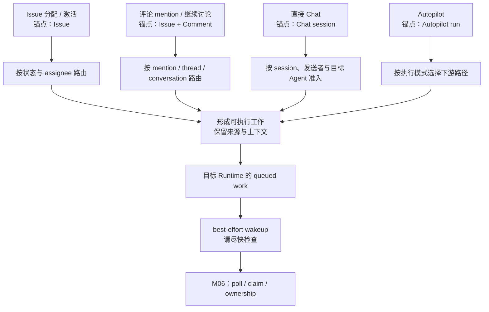
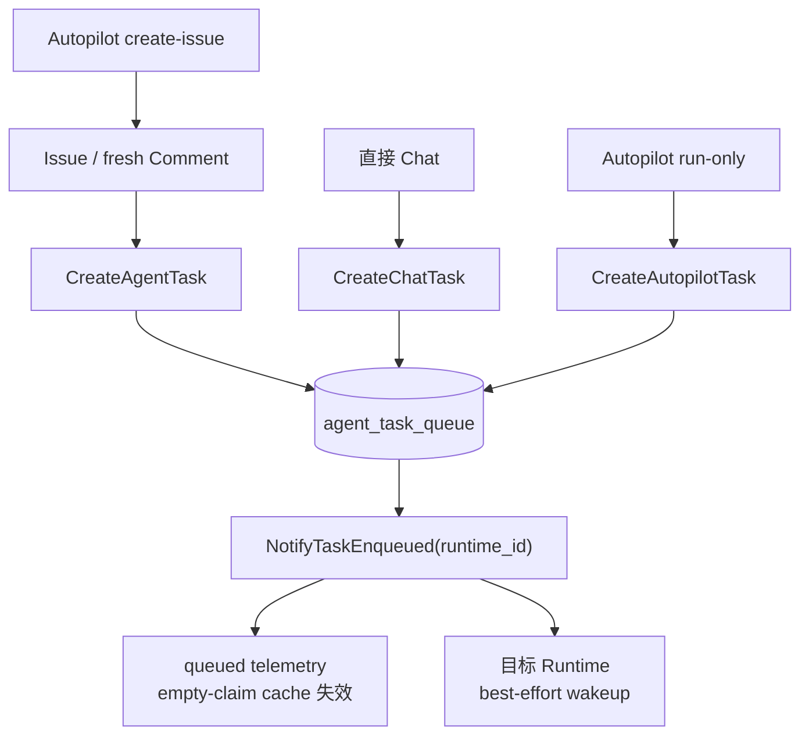

> 把 Issue 分配给 Agent 会启动一次执行；在评论里 `@` Agent 也会。直接发起 Chat、让 Autopilot 按计划运行，同样能让 Agent 工作。它们看起来不像同一种操作，为什么最后都能交给 Runtime？

短答案是：**四类入口先各自回答“为什么现在要让谁工作、允许不允许、要带什么上下文”，被接纳后再形成可执行工作，并从目标 Runtime 的通知边界进入共同主线。** “汇流”不表示它们共享同一个 handler、同一个事务或同一种上下文。

本章固定在 `multica-ai/multica@52b26900c51f759b87707b4ea35fa9f141b83b52`。讨论到 queued work 与 Runtime 提醒为止；任务如何成为完整的 durable task 留给 M05，谁真正取得执行权留给 M06。

## Agent 不是一直在线等消息

先排除一个直觉误解：Agent 不是一个常驻进程，也没有一个成员式 inbox 可以持续监听。Agent 保存的是可复用身份与执行配置。只有明确的用户或系统动作经过 Server 的路由与准入，系统才会安排一次执行；真正的 Coding Agent 进程要到后续本地执行阶段才启动。

本章把这种明确导致执行被创建或安排的动作叫作 **Trigger（触发）**。官方产品语义把它们分成四类：

1. 把 Issue 分配给 Agent，或者让已经分配的工作从 backlog 进入可执行状态；
2. 在评论中 mention Agent，或沿已有 Agent 对话继续回复；
3. 向 Agent 发送直接 Chat；
4. 由 Autopilot 的 manual、schedule、webhook 等来源发起自动化运行。

这里的“评论继续讨论”和“schedule”不是第五、六类 trigger。前者属于评论族的路由方式，后者属于 Autopilot 的来源。

## 先建立四路汇流模型

下面是一张**概念图**。每个入口都有自己的上下文锚点和路由规则；图中的“形成可执行工作”是教学语义，不是名为 `TriggerAgent()` 的真实函数。

<figure data-wide>



<figcaption><strong>CONCEPTUAL · 四类 Trigger：</strong>入口先各自完成目标解析、准入与上下文绑定，再汇到可执行记录和 Runtime 通知边界。Chat 与 run-only Autopilot 不需要 Issue；通知只提示检查，不授予执行权。</figcaption>

</figure>

图中最重要的是两段式结构：**先分流，后汇流**。

- 分流阶段关心“谁触发、目标是谁、是否允许、上下文从哪里来”。
- 汇流阶段关心“怎样把已接纳的工作保存下来，并提醒绑定的 Runtime”。

路由（routing）不是简单地把用户名换成 Agent ID。它还要结合入口对象、状态、thread 或 session，确定实际执行 Agent 及本次输入。准入则检查这次动作是否允许产生执行，例如权限、Agent 可用性和特定状态 gate。

## 用四个场景看同一个边界

假设团队有一个负责代码维护的 Agent。下面四个动作都可能让它工作，但它们带来的“为什么”和“上下文”不同。

| 场景 | 入口先解决什么 | 主要上下文锚点 | 是否必须有 Issue |
| --- | --- | --- | --- |
| 分配“修复登录问题” | 当前 Issue 状态是否允许启动，assignee 是 Agent 还是 Squad | `issue_id` | 是 |
| 评论“请检查移动端登录”并 mention Agent | mention / thread / conversation 应路由给谁，新输入是否并入待处理工作 | `issue_id`、`trigger_comment_id` | 是 |
| 直接问 Agent“解释这段错误日志” | session、目标 Agent、发送者权限与本轮输入如何绑定 | `chat_session_id` | 否 |
| 每天检查依赖更新 | 这是哪个 automation run，采用 create-issue 还是 run-only | `autopilot_run_id`，create-issue 模式另有 Issue | 不一定 |

四条路径被接纳后，都能指向实际 `agent_id` 与 `runtime_id`，并形成可执行义务。这里说“义务”，是为了保留评论路径的一个重要例外：如果同一 Issue、同一 Agent 已有待处理工作，新评论可能被合并到它，或安排为后继工作，而不是每条评论都机械插入一条新 task。

## Issue 分配：状态与 assignee 共同决定是否启动

Issue 入口不只是“看到 `assignee_id` 就入队”。Server 会观察写入后的 Issue 形状与这次变化：新建或重新分配的非 backlog Issue 可以触发执行；已经分配的固定 backlog 工作离开 backlog、进入非终态时，也可以恢复启动。

反过来，把工作放在 backlog 是停车，而不是立即执行。Agent 已归档、没有 Runtime，或其他准入条件不满足时，也不会按正常路径形成可立即执行的 task。Runtime 暂时 offline 与“没有 Runtime”不同：普通工作仍可先排队，等待执行侧回来发现。

如果 assignee 是 Squad，系统会解析到 Squad leader；真正写入 task 的 `agent_id` 是 leader，同时保留 Squad 相关字段。M04 只需要知道这一步仍然产生一个实际执行目标，多 Agent 协作方式留给 M16。

> 源码定位
>
> - `server/internal/service/issue_trigger.go`：`(*IssueService).WillEnqueueRun`
> - `server/internal/handler/issue_trigger.go`：`(*Handler).dispatchIssueRun`
> - `server/internal/service/task.go`：`(*TaskService).enqueueIssueTaskWithCommentPlan`

## 评论触发：mention 只是评论族的一种路由方式

评论入口常被简称为“mention Agent”，实际覆盖的路由更广：

- 显式 `@agent` 直接指定目标；
- `@squad` 解析到 Squad leader；
- 回复 Agent 或既有对话 thread，可以沿 conversation owner 继续；
- 普通顶层评论在适用条件下可以回退到 Issue assignee；
- `/note` 明确只留笔记，不触发 Agent。

因此，mention 不是向 Agent inbox 发一条通知，而是产生或补充执行义务。路由器先从评论内容、thread 和既有 conversation 找到实际目标，再决定新建、合并还是延后本次工作。

设想 Agent 已有一项 queued 工作，这时用户连续补充两条评论。产品上，两条评论都表达了需要 Agent 处理的新输入；实现上，它们可以被合并进待处理 task，或被安排到当前工作之后。**不能把“一次评论动作”推导成“一定新增一行 `agent_task_queue`”。** 本章也不继续展开运行中 steering 和完成时 reconciliation 的全部竞态与恢复分支。

> 源码定位
>
> - `server/internal/handler/comment.go`：`(*Handler).computeCommentAgentTriggers`
> - `server/internal/handler/comment.go`：`triggerTasksForComment`, `resolveCommentTriggerEnqueue`
> - `server/internal/service/task.go`：`enqueueMentionTaskWithCommentPlan`

## 直接 Chat：没有 Issue，也能形成一次执行

直接 Chat 证明了 Run 不必从 Issue 开始。用户向某个 Agent 发送消息时，入口先加载活跃 `chat_session` 与目标 Agent，检查 Agent readiness 和调用权限；随后在一个事务里完成三件关键事：

1. 创建 `issue_id = NULL`、带 `chat_session_id` 的 queued task；
2. 把这次用户 turn 的输入所有权绑定给该 task；
3. 创建引用同一 `task_id` 的 Chat message。

事务提交后，系统才发出 queued 事件并提醒目标 Runtime。这样，工作记录和这次用户输入不会被拆成两个互相找不到的事实。

Chat 与 Issue 路径最终进入同一张执行队列表，却没有 `issue_id`。它的上下文锚点是 `chat_session_id` 以及 task 自己拥有的输入 batch。Channel-backed Chat 还可能包含 debounce、媒体 gate 和 delivery snapshot；这些变体不改变本章用 direct Chat 建立的主模型，详细上下文组装留给后文。

> 源码定位
>
> - `server/internal/handler/chat.go`：`(*Handler).SendChatMessage`
> - `server/internal/service/task.go`：`(*TaskService).SendDirectChatMessage`
> - `server/pkg/db/queries/chat.sql`：`CreateChatTask`

## Autopilot：一种自动化 Trigger，两种下游模式

Autopilot 可以由 manual、schedule、webhook 或 API 等来源发起。这些是同一自动化 trigger 族的来源，不是彼此独立的顶层类别。每次 dispatch 先创建 `autopilot_run`，保存 source、trigger 和 payload 等 automation 级信息，再根据 execution mode 进入两条路径：

- **create-issue**：先创建 `origin_type=autopilot` 的 Issue，再复用普通 Agent / Squad Issue 入队路径；
- **run-only**：不创建 Issue，直接创建带 `autopilot_run_id`、`issue_id = NULL` 的 queued task。

两条路径最后都能进入 task queue，并把 task 关联回本次 `autopilot_run`。区别没有在汇流时消失：create-issue 模式拥有可持续协作的 Issue，run-only 模式则以 automation run 作为主要来源锚点。

本章不能把 Autopilot 简化成“cron 直接调用 Agent”。调度器、webhook 验签、准入 principal、quota、幂等和故障修复都是独立机制，留给 M17 与 M18。

> 源码定位
>
> - `server/internal/service/autopilot.go`：`(*AutopilotService).DispatchAutopilot`
> - 同文件：`dispatchCreateIssue`, `dispatchRunOnly`
> - `server/pkg/db/queries/autopilot.sql`：`CreateAutopilotRun`, `CreateAutopilotTask`

## 三种写入形状，汇到同一队列

“四类 Trigger”不是“四个 SQL”。Issue 与评论族使用 `CreateAgentTask`；直接 Chat 使用 `CreateChatTask`；run-only Autopilot 使用 `CreateAutopilotTask`。Autopilot 的 create-issue 分支则先回到普通 Issue 路径。三种 query 都写入 `agent_task_queue`，但携带不同来源锚点。

下面是绑定固定提交的**实现图**。它只画已验证的 fresh enqueue 路径；评论 coalescing 因为可能不插入新行，作为旁路说明而不伪装成第四种 insert。

<figure data-wide>



<figcaption><strong>IMPLEMENTATION · 入队与通知边界：</strong>四类入口并不共享一个 insert helper；三种 query 写入同一 <code>agent_task_queue</code>，fresh enqueue 再进入 <code>NotifyTaskEnqueued</code>。Autopilot create-issue 复用 Issue 路径；评论也可能合并或延后，而不新增记录。</figcaption>

</figure>

同一张表不会抹平来源。固定提交中的 task 可以通过以下字段说明自己从哪里来：

| Trigger family | 代表写入 | 主要来源锚点 |
| --- | --- | --- |
| Issue assignment | `CreateAgentTask` | `issue_id` 与 attribution / evidence 字段 |
| Comment | `CreateAgentTask`，或合并 / 延后义务 | `issue_id`、`trigger_comment_id`、planned / coalesced comment ids |
| Direct Chat | `CreateChatTask` | `chat_session_id`，`issue_id = NULL` |
| Autopilot run-only | `CreateAutopilotTask` | `autopilot_run_id`，`issue_id = NULL` |
| Autopilot create-issue | 普通 Issue 写入路径 | `autopilot_run` 关联与新建 Issue |

此外，`originator_source`、`trigger_evidence_kind` / `ref_id` 以及 accountable / originator identity 等字段保留 attribution 与触发证据。这里列的是固定提交中的代表来源；`trigger_evidence_kind` 可扩展，不能把这张表解释成未来所有 trigger 的封闭枚举。

## Runtime 被提醒，不等于 Agent 已经执行

新 task 成功排队后，`NotifyTaskEnqueued` 会记录 queued telemetry、让 empty-claim cache 失效，并按 `runtime_id` 尝试提醒目标 Runtime。这个提醒是 **best-effort wakeup**：它的含义是“可能有新工作，请尽快检查”。

它不表示：

- Runtime 一定收到通知；
- 某个 Daemon 已经拿到 task；
- task 已经从 `queued` 变成后续状态；
- Coding Agent 进程已经启动；
- 工作在所有故障场景下只会执行一次。

Issue、评论和 Chat 路径还会显式广播 queued event；run-only Autopilot 不经过同一个 broadcast helper。共同点是 task queue 与 Runtime 通知边界，不是每个辅助事件都相同。

把“Agent 开始工作”拆成四个时刻会更准确：

```text
触发产生意图
  → Server 完成路由、准入与持久化
  → Runtime 请求并获得执行权
  → 本地 Coding Agent 进程真正运行
```

M04 解释前两段，并停在 Runtime 提醒；M06 解释 claim 与 ownership；M03 及后续本地执行章节解释进程怎样真正运行。这样就不会把“用户按下按钮”“数据库已有 queued task”“Runtime 收到提醒”和“Codex 已经启动”压成一个模糊瞬间。

## 为什么要保留来源差异？

下面是基于已验证结构的**工程解释（INFERENCE）**，不是源码注释直接声明的作者动机：

> 共同队列让执行侧可以围绕 Agent、Runtime 和 task 处理工作；来源锚点则让系统与后续上下文组装仍然知道“为什么有这次执行、应该读取哪段协作历史”。

这条解释由几项事实支撑：三种 insert 写同一 `agent_task_queue`；task 都能指向实际 Agent 与 Runtime；Issue、Comment、Chat 和 Autopilot 又分别保留自己的来源字段。现有证据不足以据此宣称它们拥有相同的幂等、事务或上下文语义。

## 容易混淆的七件事

1. **Agent 配置不是常驻 worker。** Trigger 安排一次执行，Coding Agent 进程要在后续阶段才启动。
2. **mention 不是成员通知。** 对 Agent 的评论路由会形成或补充执行义务。
3. **四类是产品 taxonomy，不是四个 endpoint。** 每类内部都可能有多个入口或子分支。
4. **汇流不等于统一 handler。** 四类入口的准入、事务和上下文结构不同。
5. **一条评论不保证新增一条 task。** pending work 可以 coalesce，后续义务也可以被延后安排。
6. **Run 不一定有 Issue。** Direct Chat 与 run-only Autopilot 的 `issue_id` 可以为 NULL。
7. **wakeup 不是 claim。** 提醒只加速发现，执行权由后续机制确认。

## 5 分钟快速复习

试着不用函数名回答：

1. 四类 Trigger 分别是什么？reply、schedule 为什么不是新的顶层类别？
2. 为什么要把入口处理拆成路由 / 准入与共同执行主线？
3. Issue、Comment、Chat 与 Autopilot 的上下文锚点有什么不同？
4. 为什么不能说“每个 Trigger 都新增一条 task”？
5. Autopilot 的 create-issue 与 run-only 有什么差别？
6. 三种 insert 为什么仍能叫作汇流？
7. 为什么 Runtime wakeup 不等于获得执行权？

如果能说出下面这句话，就掌握了本章主线：

> 四类入口先各自解析目标、权限与上下文；被接纳的工作再以保留来源的 task 进入共同队列，并提醒绑定 Runtime。入口差异不会消失，而提醒也不授予执行权。

---

## 附录：源码导航

下面的准确标识符用于核对固定提交，不是理解正文前需要背诵的术语。

### Source Map

| 源码位置 | 关键 symbol | 证明什么 | 证据 |
| --- | --- | --- | --- |
| `server/internal/service/issue_trigger.go` | `(*IssueService).WillEnqueueRun` | Issue create / assign / backlog promotion 是否产生执行 | `SOURCE` |
| `server/internal/handler/issue_trigger.go` | `(*Handler).dispatchIssueRun` | 已接纳的 Issue trigger 路由到 Agent 或 Squad leader 入队方法 | `SOURCE` |
| `server/internal/handler/comment.go` | `(*Handler).computeCommentAgentTriggers`, `triggerTasksForComment`, `resolveCommentTriggerEnqueue` | mention、thread、conversation 与 assignee fallback 的评论路由及合并 / 延后 / 新建决策 | `SOURCE` |
| `server/internal/service/task.go` | `enqueueIssueTaskWithCommentPlan`, `enqueueMentionTaskWithCommentPlan` | Issue 与评论构造带来源字段的 issue-linked task | `SOURCE` |
| `server/internal/handler/chat.go` | `(*Handler).SendChatMessage` | Direct Chat 的 session、权限与 readiness preflight | `SOURCE` |
| `server/internal/service/task.go` | `(*TaskService).SendDirectChatMessage` | 事务内绑定 Chat task、用户 turn 与 message | `SOURCE` |
| `server/internal/service/autopilot.go` | `(*AutopilotService).DispatchAutopilot`, `dispatchCreateIssue`, `dispatchRunOnly` | Autopilot 来源进入 create-issue 或 run-only 模式 | `SOURCE` |
| `server/pkg/db/queries/agent.sql` | `CreateAgentTask` | Issue / fresh Comment 写入 `agent_task_queue` | `SOURCE` |
| `server/pkg/db/queries/chat.sql` | `CreateChatTask` | Direct Chat 以 `chat_session_id` 写入同一队列 | `SOURCE` |
| `server/pkg/db/queries/autopilot.sql` | `CreateAutopilotRun`, `CreateAutopilotTask` | Autopilot 保存 automation run，并让 run-only task 关联来源 | `SOURCE` |
| `server/internal/service/task.go` | `(*TaskService).NotifyTaskEnqueued`, `notifyTaskAvailable`, `notifyRuntimeMayHaveWork` | fresh enqueue 后更新队列 bookkeeping 并提醒目标 Runtime | `SOURCE` |
| 官方文档 | `triggering-agents`, `how-multica-works`, `mentioning-agents`, `tasks`, `autopilots` | 四类产品 taxonomy、评论继续路由与 Autopilot 模式 | `DOCS` |

### 精确执行 / 调用链

以下路径只保留 M04 需要的入口、写入和通知；参数校验、完整 coalescing、事件发布与后续 claim 均按章节边界省略。

```text
Issue assignment / activation
  → IssueService.WillEnqueueRun
  → Handler.dispatchIssueRun
  → EnqueueTaskForIssueWithHandoff | EnqueueTaskForSquadLeaderWithHandoff
  → enqueueIssueTaskWithCommentPlan | enqueueMentionTaskWithCommentPlan
  → CreateAgentTask(status = queued, issue_id, runtime_id, provenance...)
  → NotifyTaskEnqueued(runtime_id)

Comment mention / continuation
  → triggerTasksForComment
  → computeCommentAgentTriggers
  → resolveCommentTriggerEnqueue
  → merge / defer / enqueueSingleCommentTrigger
  → EnqueueTaskForMention | EnqueueTaskForThreadParent
     | EnqueueTaskForIssue | EnqueueTaskForSquadLeader
  → fresh path: CreateAgentTask(status = queued, trigger_comment_id, ...)
  → NotifyTaskEnqueued(runtime_id)

Direct Chat
  → Handler.SendChatMessage
  → AgentReadiness + canInvokeAgent
  → TaskService.SendDirectChatMessage
  → transaction: CreateChatTask + SetChatTaskInputOwnerSelf
                 + CreateChatMessage + attachments / session update
  → commit
  → NotifyTaskEnqueued(runtime_id)

Autopilot
  → AutopilotService.DispatchAutopilot*
  → CreateAutopilotRun(source, trigger_id, payload, ...)
  → create_issue: create Issue → ordinary Issue enqueue path
  → run_only: CreateAutopilotTask(status = queued, autopilot_run_id)
  → NotifyTaskEnqueued(runtime_id)
```

### 源码基线、研究依据与未决问题

- 上游仓库：`multica-ai/multica`
- 完整 commit SHA：`52b26900c51f759b87707b4ea35fa9f141b83b52`
- 研究产物：`research/trigger-convergence/research-note.md`
- 图示证据：`research/trigger-convergence/diagram-evidence.md`
- 证据类型：实现路径、写入形状、来源字段和 Runtime 通知以 `SOURCE` 为主；四类 taxonomy、评论与 Autopilot 产品语义参考 `DOCS`；本章没有新增 `EXPERIMENT`。
- `INFERENCE`：把共同 queue 与来源锚点解释为“执行侧统一处理、上下文仍可追溯”是基于已验证结构的工程解释，不是作者动机声明。

现有证据没有完整证明：queue 的 durable-task 语义与全部状态、wakeup 必达、polling / claim fairness、exactly-once execution、评论 completion reconciliation 的全部竞态、Channel Chat 的全部媒体 / debounce 分支，以及 Autopilot 的调度、webhook 安全、quota、幂等与故障修复。升级上游版本时，至少要重新核验四类入口的路由 / 准入、三个 create query、来源字段、评论 coalescing 和 `NotifyTaskEnqueued` 边界。
